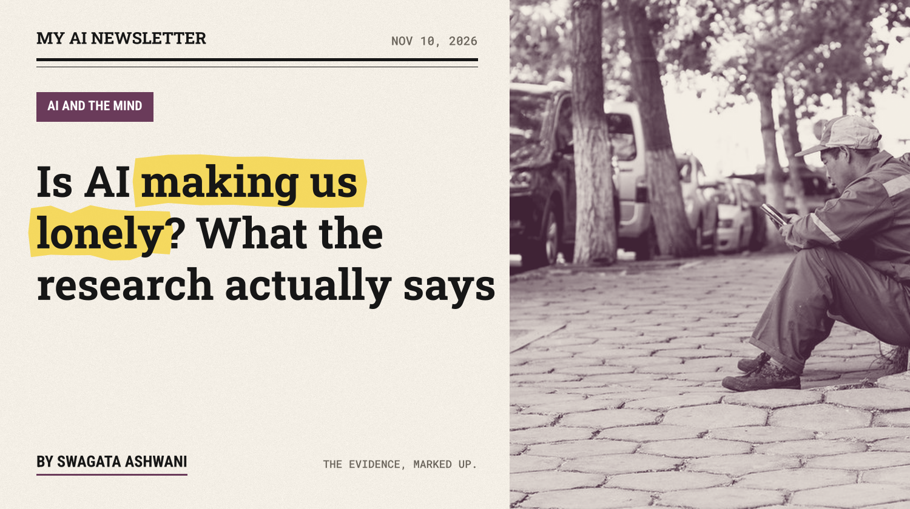
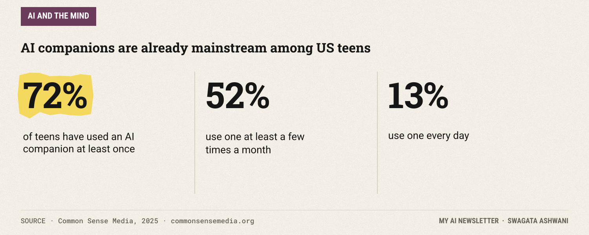
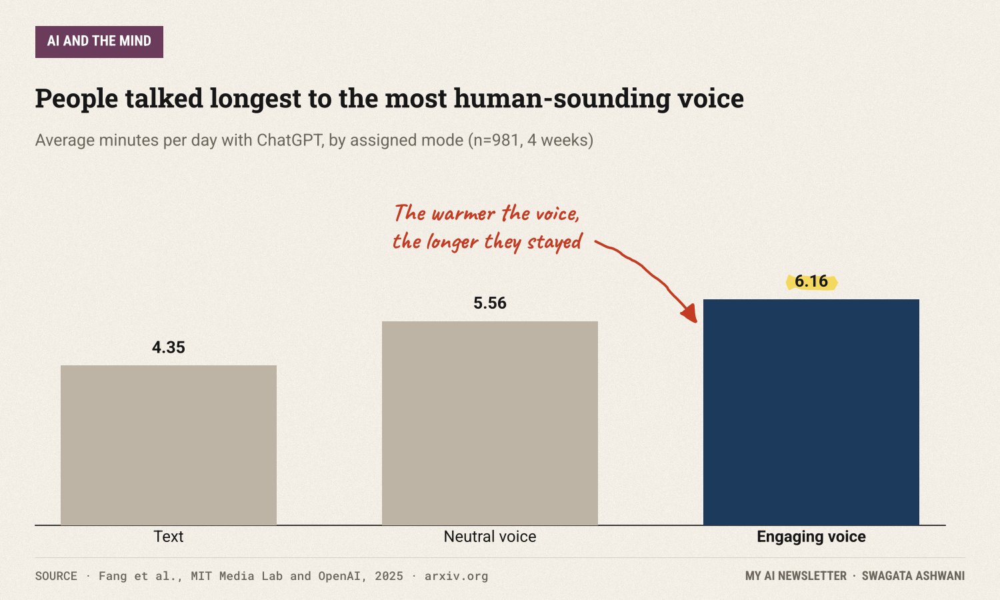
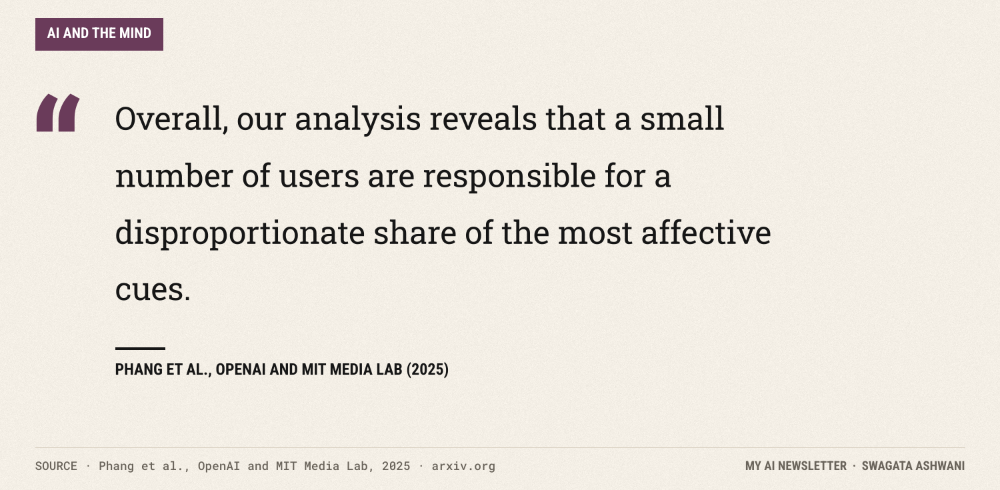
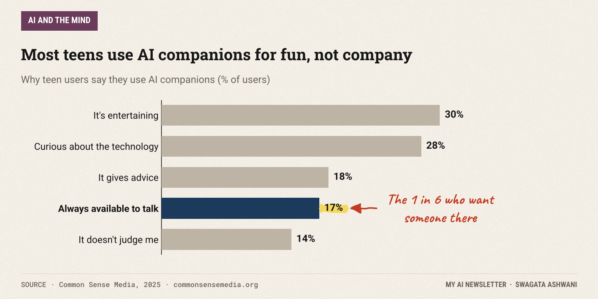
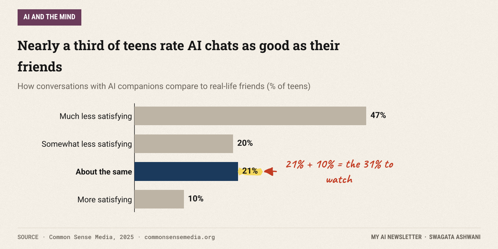
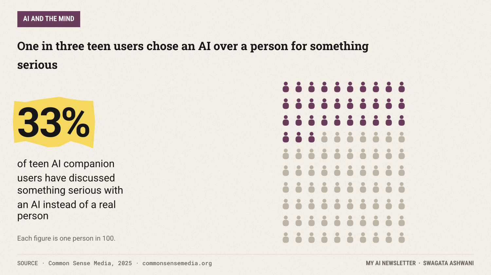
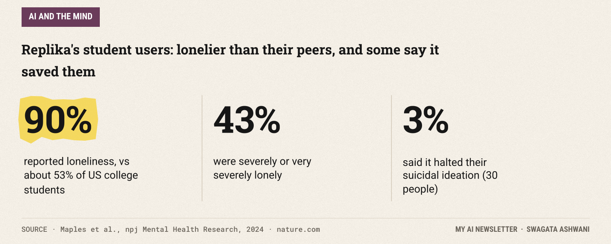
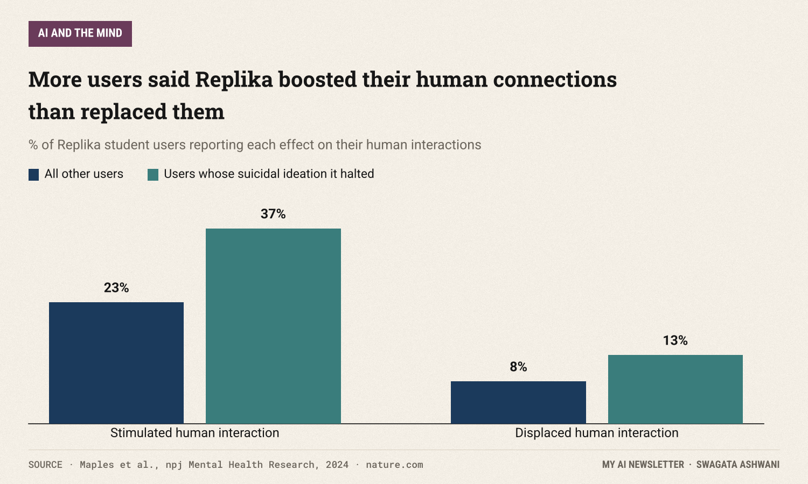

# Is AI making us lonely? What the research actually says

*Four major studies, one consistent pattern: the trouble isn't talking to AI, it's who talks to it most.*

Seventy-two percent of American teenagers have now talked to an AI companion at least once. Thirteen percent do it every day. That figure comes from a nationally representative survey of 1,060 teens published by Common Sense Media last year ([Common Sense Media, 2025](https://www.commonsensemedia.org/research/talk-trust-and-trade-offs-how-and-why-teens-use-ai-companions)), and it means the question in this issue's headline is no longer hypothetical.

So: is all this talking to machines making us lonelier? Or is it, for some people, the thing keeping loneliness at bay? I read the main studies so you don't have to. The answer is more interesting than either camp on social media would like.

## The short answer

For most people, in short doses, chatting with an AI seems to do little harm and may even take the edge off loneliness for a while. The trouble shows up at the heavy end. Across the best study we have, the people who used a chatbot the most were lonelier, saw other people less, and leaned on the bot more. What we can't yet say is which came first: does heavy use make people lonely, or do lonely people use it heavily? Probably some of both.

## The biggest experiment so far

In early 2025, researchers at MIT Media Lab and OpenAI ran the largest controlled experiment on this question to date ([Fang et al., 2025](https://arxiv.org/abs/2503.17473)). They recruited 981 people and had them use ChatGPT every day for four weeks, sending more than 300,000 messages in total.

The clever part was the design. Participants were randomly assigned to talk by text, by a neutral voice, or by a warmer, more "engaging" voice, and to have open-ended, personal, or impersonal conversations. Every week, the team measured four things: loneliness, how much people socialized with real humans, emotional dependence on the AI, and problematic use.

On average, people spent 5.32 minutes a day with the chatbot. But averages hide a lot. The lightest user averaged about one minute a day. The heaviest averaged 27.65 minutes.

Here is the first surprise: the experimental conditions themselves made no significant difference. Voice versus text, personal versus impersonal topics, none of it moved the needle on its own. In the authors' words, "participants who voluntarily used the chatbot more, regardless of assigned condition, showed consistently worse outcomes."

That is the core finding. More daily minutes went with more loneliness, less time with real people, more emotional dependence and more problematic use. And those links were strong, not marginal.

There is an important wrinkle, though. Across the whole group, loneliness actually dipped slightly over the four weeks, while socializing with real people dropped too. The researchers are careful to point out that there was no comparison group that didn't use a chatbot, so these overall changes might simply reflect the time of year. The usage pattern is the more trustworthy signal.

> The study did not find that chatbots are lonely-making by design. It found that the people who reached for them most were the ones doing worst.

A companion analysis by the same teams looked at more than 3 million real ChatGPT conversations and surveyed over 4,000 users ([Phang et al., 2025](https://arxiv.org/abs/2504.03888)). It found the same shape from a different angle: "very high usage correlates with increased self-reported indicators of dependence," and "a small number of users are responsible for a disproportionate share of the most affective cues." Most people use ChatGPT like a tool. A small group uses it like a confidant.

## The case for the defense

If you only read the MIT study, you might conclude AI companions are a slow-acting loneliness trap. A team at Harvard Business School looked at the short term and found something close to the opposite ([De Freitas et al., 2024](https://arxiv.org/abs/2407.19096)).

Across six studies, they found that talking to an AI companion reduced loneliness "on par only with interacting with another person, and more than other activities such watching YouTube videos." People also expected it to help less than it did. In a week-long follow-up, the companion "consistently reduces loneliness over the course of a week."

The most useful part of that paper is the why. The biggest factor wasn't how smart the bot was. It was whether it made people *feel heard*. That is a very human mechanism, and it explains why these apps are so sticky: being listened to, patiently, at 2am, with no judgment, is a real comfort.

Both findings can be true at once. A conversation can relieve loneliness today while a habit of those conversations, for some people, slowly replaces the harder work of reaching out to friends.

")

## What teenagers are actually doing

Teenagers are where most of the worry lands, so the Common Sense Media survey deserves a careful look. The headline numbers are big, but the details are calmer than the headlines suggested.

Most teens aren't using AI companions for emotional reasons. The top reasons are that it's entertaining (30%) and that they are curious about the technology (28%). Only 17% said it was because the companion is "always available when I need someone to talk to."

And they are not replacing their friends wholesale. Eighty percent of teen users spend more time with real friends than with AI companions. Only 6% spend more time with the AI. Two thirds (67%) say AI conversations are less satisfying than talking to friends, and almost half (47%) say they are *much* less satisfying.

But look at the other end of that chart. Thirty-one percent say talking to an AI is as satisfying as, or more satisfying than, talking to a friend. And a third of teen users (33%) have chosen to discuss something important or serious with an AI instead of a real person.

That last number is the one I keep thinking about. Choosing a bot over a person for the serious stuff once is understandable. It's private, it's always awake, it doesn't gossip. Doing it as a habit is exactly the substitution the MIT researchers worried about.

## The people who need it most

One more study fills in an important picture. Researchers at Stanford surveyed 1,006 university students who used Replika, one of the best known companion apps ([Maples et al., 2024](https://www.nature.com/articles/s44184-023-00047-6)).

These users were far lonelier than students in general: 90% reported loneliness, compared with about 53% in earlier studies of US college students, and 43% were severely or very severely lonely. Yet 90% also reported medium to high social support. Loneliness and having people around are not the same thing.

Most striking: 3% of respondents, 30 people, said Replika had halted their suicidal ideation. And more users said the app *stimulated* their human relationships (23%) than said it displaced them (8%). Among the 30 who said it helped them through suicidal thoughts, both numbers were higher.

This study has real limits. It is a self-selected survey of people who chose to keep using the app, with no comparison group, and a critique of the paper was published in the same journal in November 2025. Treat it as evidence that these tools matter enormously to some vulnerable people, not as proof that they work as therapy.

## So what's really going on?

Put the four studies side by side and a consistent story appears:

1. **Lonely people are drawn to AI companions.** Replika users were far lonelier than their peers. In the MIT study, people with "stronger emotional attachment tendencies and higher trust in the AI chatbot tended to experience greater loneliness."
2. **A conversation helps in the moment,** mostly because it makes people feel heard.
3. **Heavy, habitual use goes with worse outcomes:** more loneliness, less time with people, more dependence.
4. **For most users, it's just a tool.** Teens mostly use it for fun and curiosity, and most still prefer their friends.

The danger isn't the technology talking to us. It's the slow trade, made by the people with the least slack in their social lives, of hard human connection for easy machine connection.

")

## Who is most affected

The evidence points to three groups worth watching:

- **Heavy daily users.** Across studies, the pattern lives at the high end of usage, not the average.
- **People who are already lonely or emotionally attached.** They are both the most likely to benefit in the short term and the most likely to become dependent.
- **Younger teens.** Common Sense found 13 to 14 year olds trust AI companions' advice more than older teens do, and a third of teen users have taken serious matters to an AI instead of a person.

## What this means for you

- **Watch the minutes, not the app.** The research consistently ties harm to heavy daily use. A few minutes a day looks very different from half an hour.
- **Use it as a bridge, not a destination.** If talking something through with an AI helps you feel ready to talk to a friend, that's the good version. Notice if it starts replacing that conversation.
- **Ask the "instead of" question.** Every so often, ask: what did this replace? A late night spiral, fine. A call to your sister, worth noticing.
- **If you're a parent, start curious, not alarmed.** Most teens are using these tools for fun. Ask what they use them for and whether they've ever told a bot something they wouldn't tell you. Then listen.
- **If you or someone you know is struggling, talk to a person.** In the US, call or text 988. These tools can comfort, but they are not crisis care.

## How we researched this

I read the full text or official report of each study cited here, including the MIT and OpenAI papers on arXiv, the Common Sense Media report, the Harvard Business School working paper and the Stanford study in npj Mental Health Research. Every figure in this issue, including every chart, comes directly from those sources.

See you next week. Swagata

## References

1. Fang, C. M., Liu, A. R., Danry, V., Lee, E., Chan, S. W. T., Pataranutaporn, P., Maes, P., Phang, J., Lampe, M., Ahmad, L., & Agarwal, S. (2025). *How AI and Human Behaviors Shape Psychosocial Effects of Extended Chatbot Use: A Longitudinal Randomized Controlled Study.* arXiv:2503.17473. [Link](https://arxiv.org/abs/2503.17473)
2. Phang, J., Lampe, M., Ahmad, L., Agarwal, S., Fang, C. M., et al. (2025). *Investigating Affective Use and Emotional Well-being on ChatGPT.* arXiv:2504.03888. [Link](https://arxiv.org/abs/2504.03888)
3. Common Sense Media (2025). *Talk, Trust, and Trade-Offs: How and Why Teens Use AI Companions.* [Link](https://www.commonsensemedia.org/research/talk-trust-and-trade-offs-how-and-why-teens-use-ai-companions)
4. De Freitas, J., Uguralp, A. K., Uguralp, Z. O., & Puntoni, S. (2024). *AI Companions Reduce Loneliness.* Harvard Business School Working Paper, arXiv:2407.19096. [Link](https://arxiv.org/abs/2407.19096)
5. Maples, B., Cerit, M., Vishwanath, A., & Pea, R. (2024). *Loneliness and suicide mitigation for students using GPT3-enabled chatbots.* npj Mental Health Research, 3, 4. [Link](https://www.nature.com/articles/s44184-023-00047-6)
