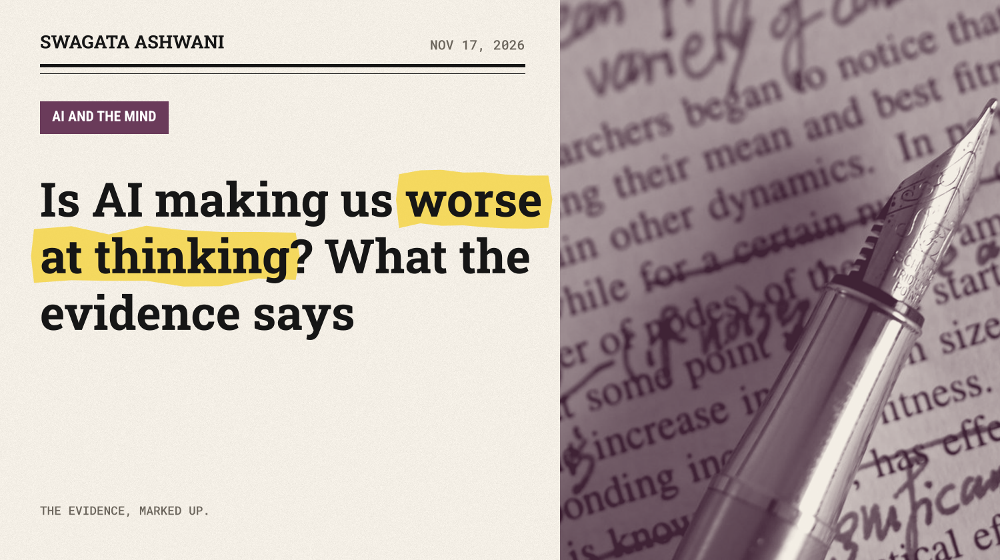
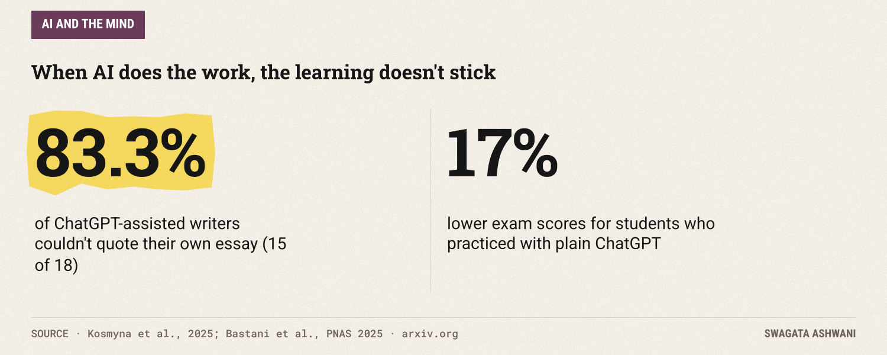
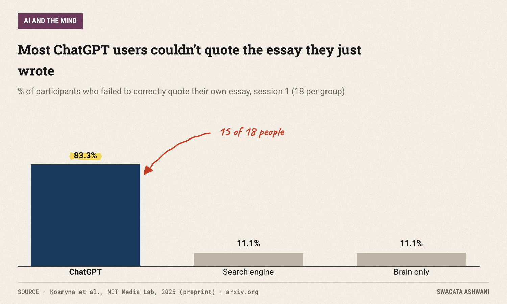
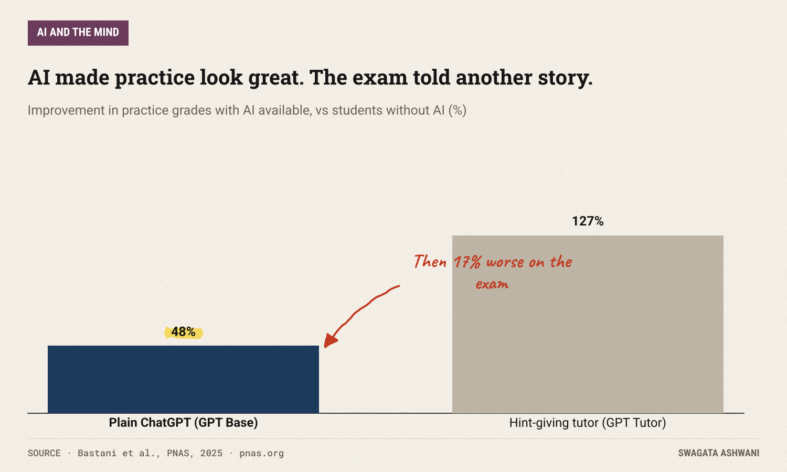
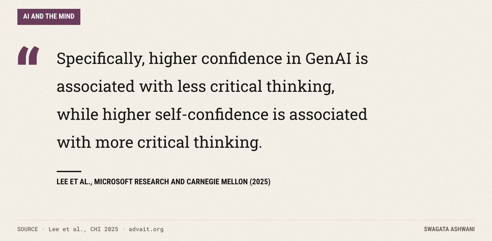
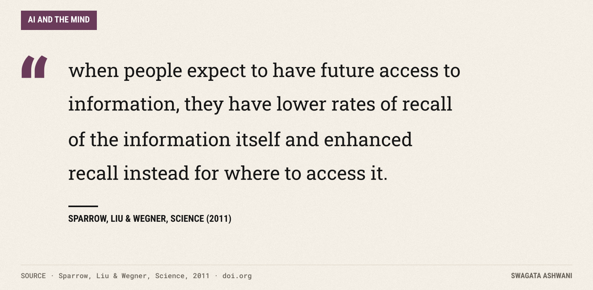

# Is AI making us worse at thinking? What the evidence says

*Brain scans, a 1,000-student experiment and a survey of 319 workers point the same way, with one big exception.*

Fifteen of eighteen. That's how many people in an MIT experiment couldn't quote a single sentence from an essay they had written minutes earlier with ChatGPT's help. Among people who wrote with only a search engine, or with nothing at all, just two out of eighteen had the same problem ([Kosmyna et al., 2025](https://arxiv.org/abs/2506.08872)).

The essay was on the page, with their name on it. It just never passed through their head.

That small, slightly eerie result sums up the worry behind this week's question. If AI does our thinking, do we get worse at it? I went through the best studies we have. The answer is not "AI makes you dumb." It's more specific, and more useful, than that.

## The short answer

When AI does the work *for* you, you learn and remember less of it, and you may feel more competent than you are. When AI is set up to make you do the work, with hints instead of answers, most of the harm goes away. The tool matters less than the way you use it. All of this research is young, and the most dramatic studies are small, so treat the details with care.

## What happens in your brain

The MIT study behind that quote result put EEG caps on 54 people and had them write essays across several sessions in one of three ways: with ChatGPT, with a search engine, or with nothing but their own brain.

The brain scans lined up with the tools. In the authors' words, "Brain-only participants exhibited the strongest, most distributed networks; Search Engine users showed moderate engagement; and LLM users displayed the weakest connectivity." The more the tool did, the less the brain did.

The behavior matched. The ChatGPT group felt the least ownership of their essays, and most of them couldn't quote what they'd written. Over four months, the authors write, "LLM users consistently underperformed at neural, linguistic, and behavioral levels."

Now the caveats, and they're big ones. This is a preprint, not yet peer reviewed, with a small sample. Other researchers have already published a detailed critique raising concerns about sample size, reproducibility and how the EEG data was analyzed ([Stankovic et al.](https://arxiv.org/abs/2601.00856)). Treat it as a vivid early signal, not settled science.

")

## The classroom experiment that changed my mind

The strongest evidence comes from a classroom. Researchers at the Wharton School ran a field experiment with nearly a thousand high school math students in Turkey, published in PNAS this year ([Bastani et al., 2025](https://www.pnas.org/doi/10.1073/pnas.2422633122)).

Some students practiced with a plain ChatGPT-style assistant ("GPT Base"). Others got "GPT Tutor," the same model but set up to give hints and guide students toward the answer instead of handing it over. A control group practiced without AI.

During practice, with AI available, both groups shot ahead: grades improved 48% with GPT Base and 127% with GPT Tutor.

Then came the exam, without AI. The GPT Base students did **17% worse** than students who never had AI at all. They had used it, as the authors put it, as a "crutch." The GPT Tutor students did about the same as the control group: no harm, but no gain either. And here's the part that stuck with me: they "perceived that they performed significantly better."

So AI produced better practice scores, worse or equal real learning, and inflated confidence. That combination should worry every student, and every manager.

## At work: confidence is the switch

What about adults at work? A team from Microsoft Research and Carnegie Mellon surveyed 319 knowledge workers, who described 936 real tasks they had done with generative AI ([Lee et al., 2025](https://www.microsoft.com/en-us/research/publication/the-impact-of-generative-ai-on-critical-thinking-self-reported-reductions-in-cognitive-effort-and-confidence-effects-from-a-survey-of-knowledge-workers/)).

The key finding is about confidence, and it runs in two directions:

People who trusted the AI more did less critical thinking. People who trusted themselves more did more of it, even though it took more effort. The researchers also found that AI changes *what* critical thinking looks like at work: less generating ideas from scratch, more verifying, integrating and overseeing what the AI produced.

That's not automatically bad. Checking work is a real skill. But it only works if you're capable of judging what you're checking, and the study found people struggle exactly when a task falls outside their expertise.

## The bigger survey, and the old precedent

A larger survey of 666 people found the same pattern from a different angle: more frequent AI use went with weaker critical thinking scores, and the link ran through "cognitive offloading," handing mental work to the tool ([Gerlich, 2025](https://doi.org/10.3390/soc15010006)). Younger people relied on AI more and scored lower. More education went with better critical thinking regardless of AI use. It's a correlation, so it can't tell us which way the arrow points.

None of this is new, exactly. In 2011, a famous study in *Science* found that when people expect to be able to look something up later, they remember where to find it rather than the thing itself ([Sparrow et al., 2011](https://doi.org/10.1126/science.1207745)).

We have always offloaded memory to tools: notebooks, calendars, search engines. The difference with AI is how much more it can take over: reasoning, writing and judging, on top of remembering. That's a bigger slice of what we usually mean by "thinking."

## So what's really going on?

Put the studies together and a clear mechanism appears:

1. **Effort is how we learn.** The struggle of writing, solving or explaining is what builds understanding and memory. Skip it, and the learning doesn't happen.
2. **AI makes it easy to skip the struggle.** Not because it's bad, but because it's good. A complete answer is always one prompt away.
3. **We can't feel the loss.** Students with AI felt they'd done better than they had. Workers who trusted AI thought less critically without noticing. The cost is invisible in the moment.
4. **Design changes the outcome.** The hint-giving tutor removed most of the harm. The difference wasn't the model; it was whether the student still had to think.

")

## Who is most affected

- **Learners.** Students and anyone building a new skill pay the highest price, because the struggle is the point.
- **Younger users.** In the 666-person survey, they leaned on AI the most and scored lowest on critical thinking.
- **People working outside their expertise.** You can't check what you don't understand, so over-trust is most likely exactly where it's most dangerous.

## What this means for you

- **Try first, then ask.** Write your own draft, outline or attempt before you open the AI. Use it to critique and improve, not to start from zero.
- **Ask for hints, not answers.** Tell it: "Don't solve this. Give me a hint and ask me a question." That's exactly what made the tutor safe.
- **Explain it back.** After using AI on something you need to know, close it and explain the idea in your own words. If you can't, you didn't learn it.
- **Keep some no-AI reps.** Like walking when you own a car, do some writing and problem solving unassisted, especially for skills you care about.
- **Be suspicious of easy confidence.** If AI made something feel effortless, check whether you actually understand it.

## How we researched this

I read the full papers or official abstracts for every study here: the MIT EEG preprint and its published critique, the PNAS field experiment, the Microsoft Research and Carnegie Mellon CHI paper, the Societies survey and the 2011 Science study. Every number in the article and charts comes directly from those sources.

Think for yourself this week. Swagata

## References

1. Kosmyna, N., Hauptmann, E., Yuan, Y. T., Situ, J., Liao, X.-H., Beresnitzky, A. V., et al. (2025). *Your Brain on ChatGPT: Accumulation of Cognitive Debt when Using an AI Assistant for Essay Writing Task.* arXiv:2506.08872. [Link](https://arxiv.org/abs/2506.08872)
2. Stankovic, M., Hirche, E., Kollatzsch, S., & Doetsch, J. N. (2026). *Comment on: Your Brain on ChatGPT.* arXiv:2601.00856. [Link](https://arxiv.org/abs/2601.00856)
3. Bastani, H., Bastani, O., Sungu, A., Ge, H., Kabakcı, Ö., & Mariman, R. (2025). *Generative AI without guardrails can harm learning: Evidence from high school mathematics.* PNAS. [Link](https://www.pnas.org/doi/10.1073/pnas.2422633122)
4. Lee, H.-P., Sarkar, A., Tankelevitch, L., Drosos, I., Rintel, S., Banks, R., & Wilson, N. (2025). *The Impact of Generative AI on Critical Thinking.* CHI 2025. [Link](https://www.microsoft.com/en-us/research/publication/the-impact-of-generative-ai-on-critical-thinking-self-reported-reductions-in-cognitive-effort-and-confidence-effects-from-a-survey-of-knowledge-workers/)
5. Gerlich, M. (2025). *AI Tools in Society: Impacts on Cognitive Offloading and the Future of Critical Thinking.* Societies, 15(1), 6. [Link](https://doi.org/10.3390/soc15010006)
6. Sparrow, B., Liu, J., & Wegner, D. M. (2011). *Google Effects on Memory: Cognitive Consequences of Having Information at Our Fingertips.* Science. [Link](https://doi.org/10.1126/science.1207745)
