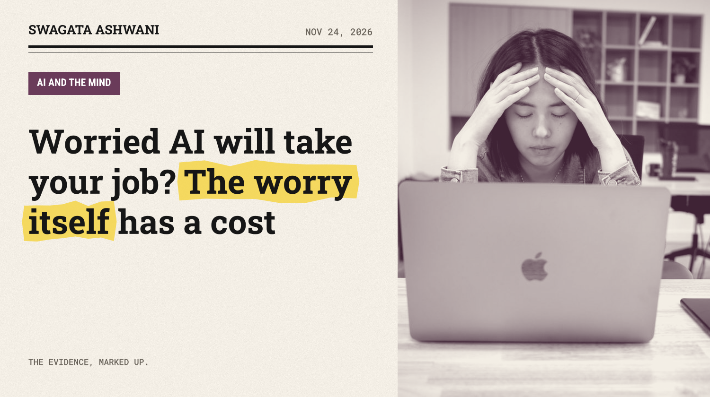
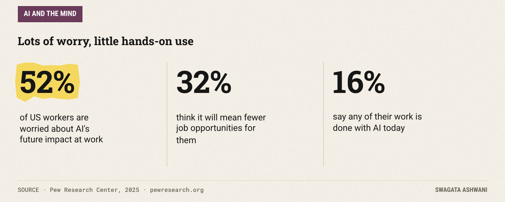
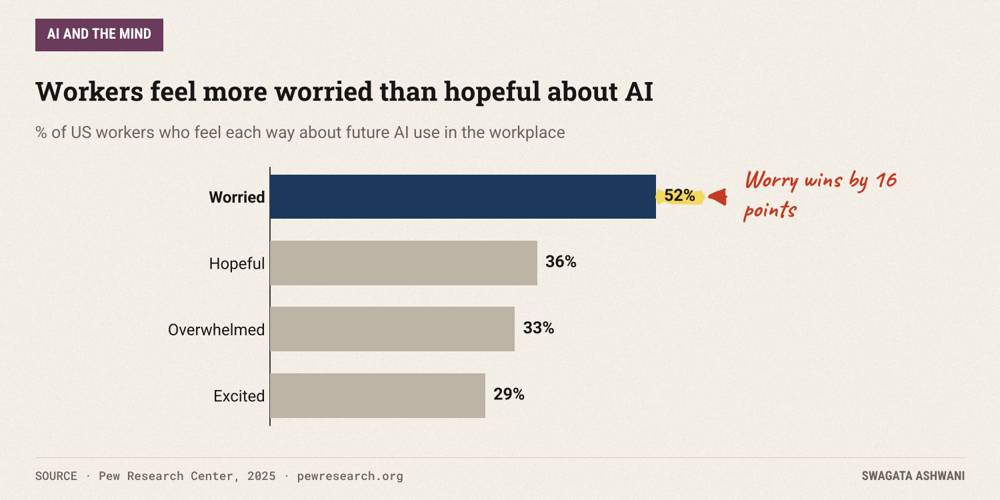
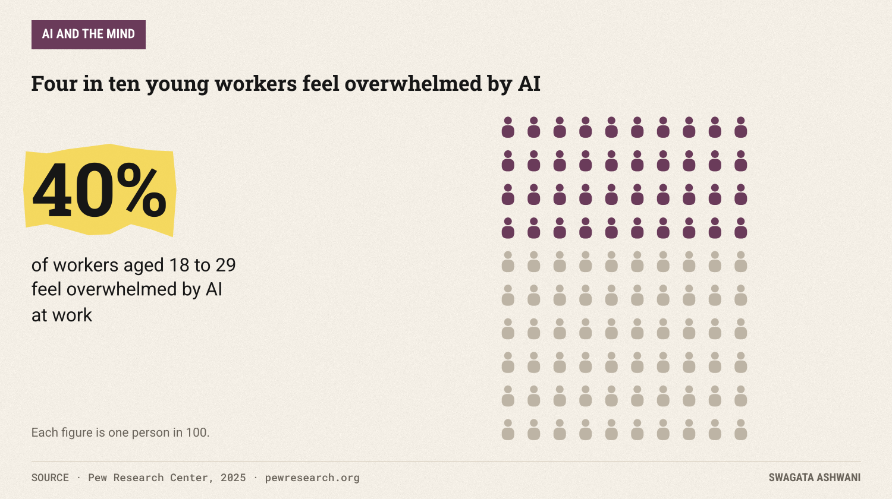
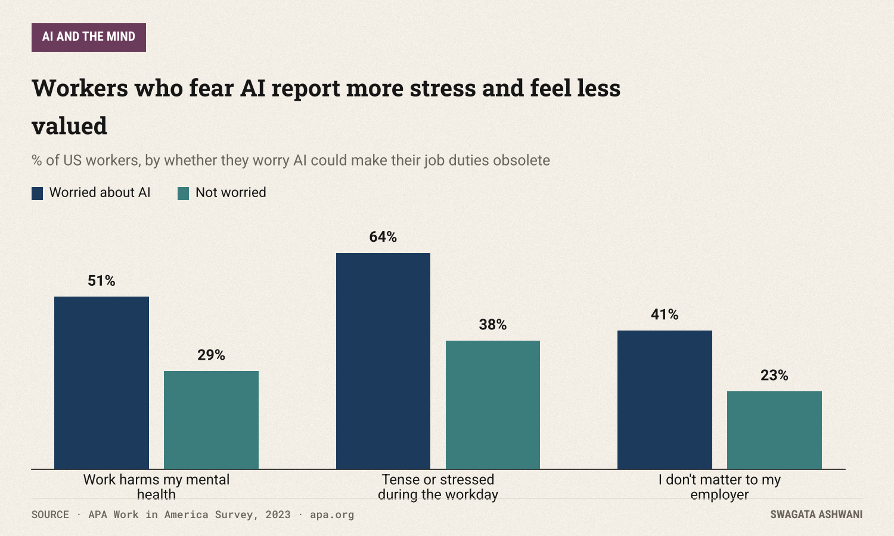
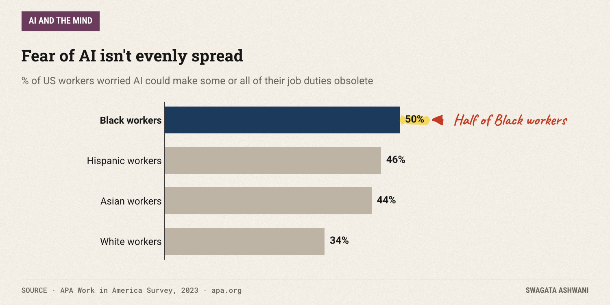
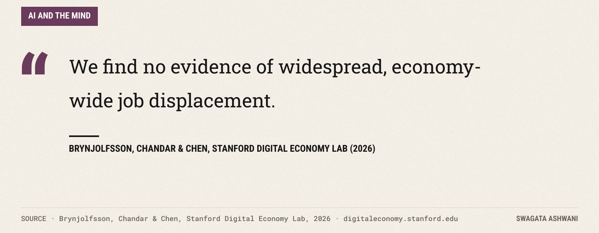
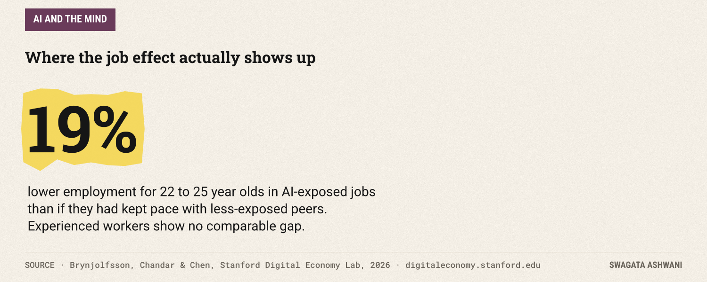

# Worried AI will take your job? The worry itself has a cost

*Half of workers fear AI. Few use it. And the fear tracks with stress, poorer mental health and feeling invisible at work.*

Half of American workers are worried about what AI will do to their jobs. Only 16% say any of their work is actually done with AI yet. That gap, between a fear that's everywhere and a technology that mostly isn't, is the subject of this week's issue.

Those numbers come from a Pew Research Center survey of 5,273 workers ([Pew, 2025](https://www.pewresearch.org/social-trends/2025/02/25/u-s-workers-are-more-worried-than-hopeful-about-future-ai-use-in-the-workplace/)). And the worry is more than a passing mood. The best data we have suggests it travels with stress, poorer mental health and a feeling of not mattering at work.

## The short answer

Fear of being replaced by AI is common, it's linked to measurably worse wellbeing at work, and it hits some groups much harder than others. The job losses themselves are, so far, narrower than the fear: there's no sign of economy-wide displacement, but early-career workers in exposed jobs are already finding fewer openings. So the anxiety isn't irrational. It's just aimed a little wide.

## How workers actually feel

Pew asked workers how they feel about AI's future role in their workplace. Worry won, clearly.

Fifty-two percent said they're worried. Thirty-six percent said hopeful, about the same share (33%) said overwhelmed, and 29% said excited. And 32% think AI will mean fewer job opportunities for them in the long run.

The youngest workers feel it most. Forty percent of workers aged 18 to 29 say they feel overwhelmed, compared with about three in ten in older groups.

Notice the odd shape of this fear. Most workers aren't using AI much yet: a majority (55%) say they rarely or never use AI chatbots at work. People are anxious about a change they mostly haven't experienced. That's often when anxiety is strongest, because imagination fills the gap.

## What the worry does to people

The clearest evidence on mental health comes from the American Psychological Association's Work in America survey ([APA, 2023](https://www.apa.org/pubs/reports/work-in-america/2023-work-america-ai-monitoring)). Thirty-eight percent of workers said they worry AI might make some or all of their job duties obsolete. Then APA compared those workers with everyone else.

The differences are large. Among workers worried about AI, 51% said their work harms their mental health, versus 29% of those who weren't worried. Sixty-four percent said they typically feel tense or stressed during the workday, versus 38%. And 41% said they feel they don't matter to their employer, compared with 23%.

That last one deserves attention. Worry about AI isn't only "will I have a job?" It's also "does anyone here value what I do?" When a company talks loudly about automation and quietly about people, workers hear the second message.

One honest caveat: this is a survey taken at one point in time. APA itself says the worries "may be connected to" poor mental health. It can't tell us whether AI worry causes stress or stressed people worry more about AI. Probably both.

")

## Not everyone carries the same load

The fear isn't evenly spread. In APA's data, Black (50%), Hispanic (46%) and Asian (44%) workers were more likely to worry about AI replacing their job duties than white workers (34%). Workers with a high school education or less were more worried than those with a four-year degree or more (44% versus 34%).

These are often the same workers with less financial cushion and fewer options if a role changes. Worry tracks vulnerability.

## Is the fear justified?

This is where the data gets interesting. The most detailed tracking we have comes from Stanford's Digital Economy Lab, which analyses payroll data from ADP covering millions of US workers, updated through June 2026 ([Brynjolfsson, Chandar & Chen, 2026](https://digitaleconomy.stanford.edu/publications/canaries-in-the-coal-mine/)).

Their headline finding is reassuring for most people. But there's a sharp exception: employment of workers aged 22 to 25 in AI-exposed occupations now stands 19% below where it would be if it had kept pace with less-exposed peers. Experienced workers show no comparable gap.

Two details matter. First, this is happening mainly through *less hiring* of young workers, not through layoffs. The door is narrowing, not slamming. Second, the declines are concentrated in jobs where AI substitutes for human tasks. Where AI mostly complements workers, employment is flat or rising. The authors are careful to call these "early, descriptive indicators," not proof of cause.

So the anxiety has a real basis, but it's aimed too broadly. Most workers today face a changing job, not a vanished one. Young people entering exposed fields face a tougher entry point.

## What's really going on

Put it together:

1. **Fear runs ahead of reality.** Half of workers are worried; about one in six use AI in their work at all.
2. **The worry travels with real distress:** more stress, poorer mental health, and the sense of not mattering.
3. **It lands hardest on those with the least cushion.**
4. **The actual job effects are specific:** fewer entry-level openings in roles where AI replaces tasks, not mass layoffs.

The cruel part is that chronic worry has costs right now, for a future that, for most people, may look quite different from the one they fear.

")

## What this means for you

- **Get specific.** "AI will take my job" is unworkable. "AI will do X part of my job" is something you can plan for. List the tasks you do and mark which ones AI could substitute and which it would only speed up.
- **Move toward the complement side.** The Stanford data suggests jobs where AI helps rather than replaces are holding up. Learn to use AI on your own work before it's decided for you.
- **Use it a little.** Many anxious workers have barely tried these tools. Fifteen minutes a day of hands-on use usually replaces dread with a clearer picture of what it can and can't do.
- **If you manage people, say the quiet part out loud.** The "I don't matter here" finding is the one leaders can fix fastest. Be explicit about how roles will change, and how you'll invest in the people in them.
- **If you're early in your career, aim for skills AI complements**, like judgment, client work and owning outcomes, and build a portfolio that shows you can work *with* the tools.
- **Treat persistent dread like any other stress.** If worry about work is affecting your sleep or mood, that's worth talking to someone about.

## How we researched this

I read the Pew Research Center report and survey PDF, the APA Work in America report and press release, and Stanford Digital Economy Lab's latest revision of its payroll study. Every figure in the text and charts comes directly from those sources.

Look after yourself this week. Swagata

## References

1. Pew Research Center (2025). *U.S. Workers Are More Worried Than Hopeful About Future AI Use in the Workplace.* [Link](https://www.pewresearch.org/social-trends/2025/02/25/u-s-workers-are-more-worried-than-hopeful-about-future-ai-use-in-the-workplace/)
2. American Psychological Association (2023). *2023 Work in America Survey: Artificial intelligence, monitoring technology, and psychological well-being.* [Link](https://www.apa.org/pubs/reports/work-in-america/2023-work-america-ai-monitoring)
3. American Psychological Association (2023). *Worries about AI, surveillance at work may be connected to poor mental health* (press release). [Link](https://www.apa.org/news/press/releases/2023/09/artificial-intelligence-poor-mental-health)
4. Brynjolfsson, E., Chandar, B., & Chen, R. (2026). *Canaries in the Coal Mine? Six Facts about the Recent Employment Effects of Artificial Intelligence.* Stanford Digital Economy Lab, revised August 12, 2026. [Link](https://digitaleconomy.stanford.edu/publications/canaries-in-the-coal-mine/)
