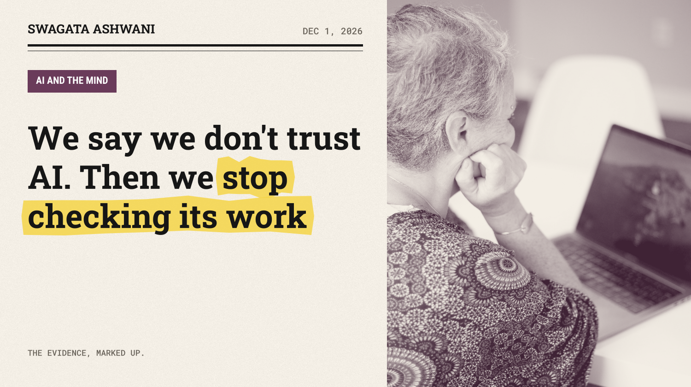
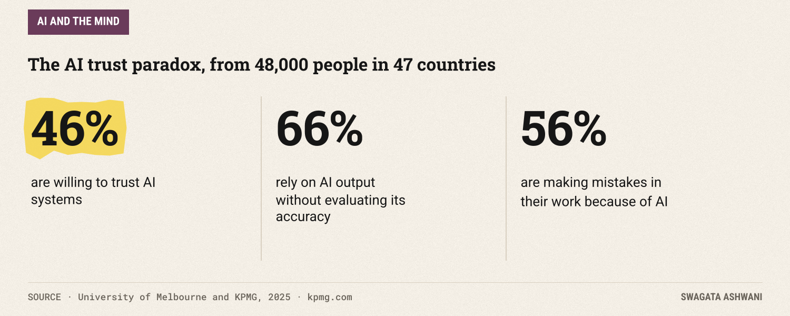
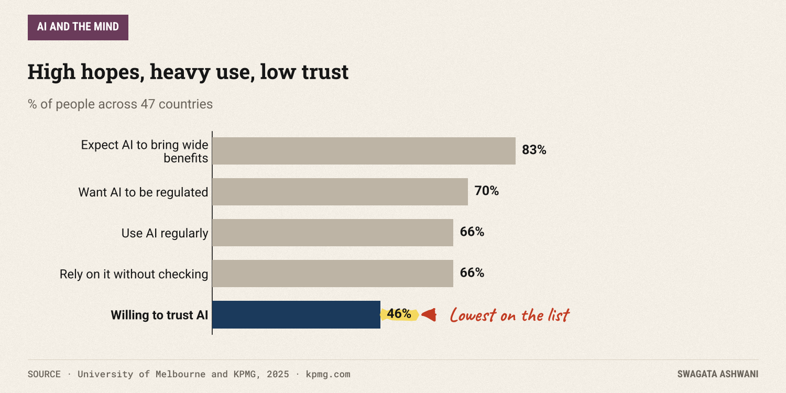
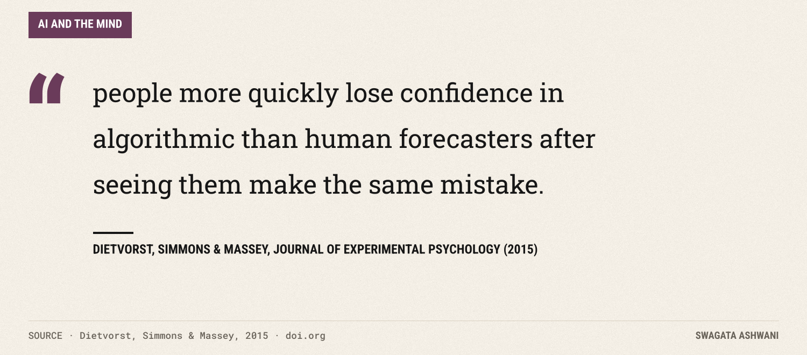
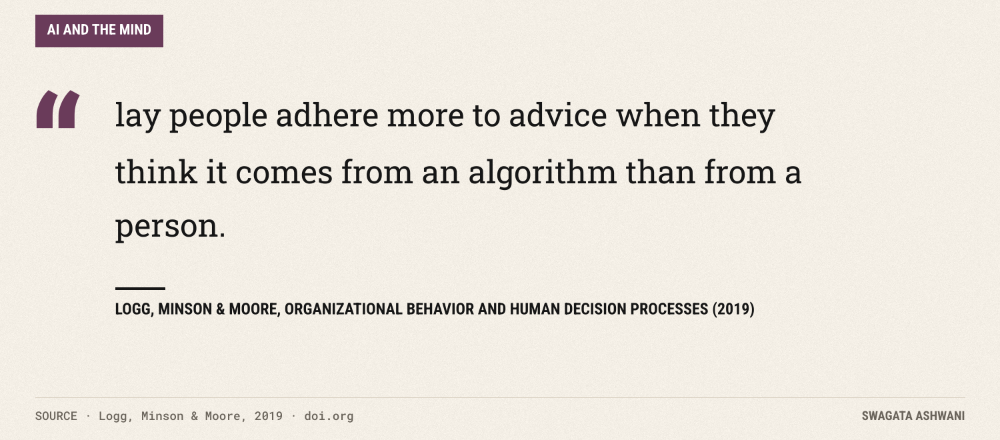
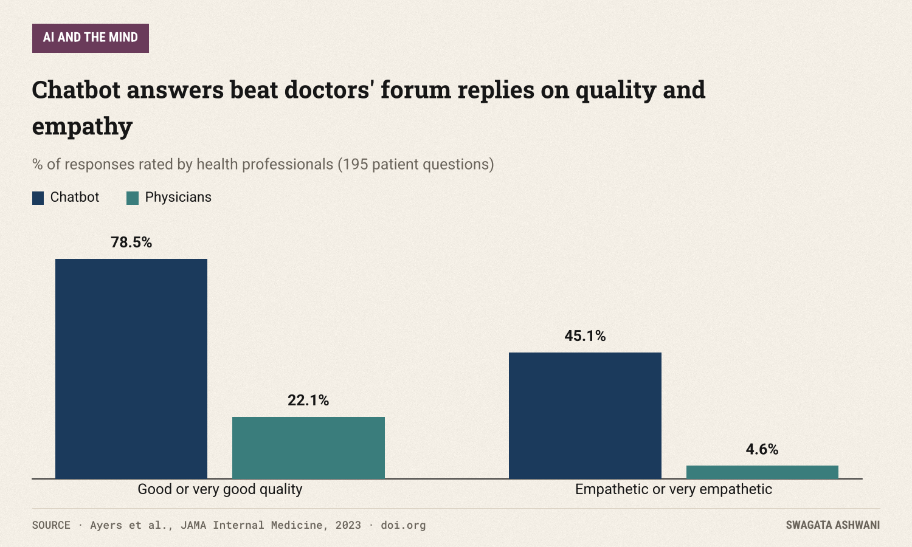
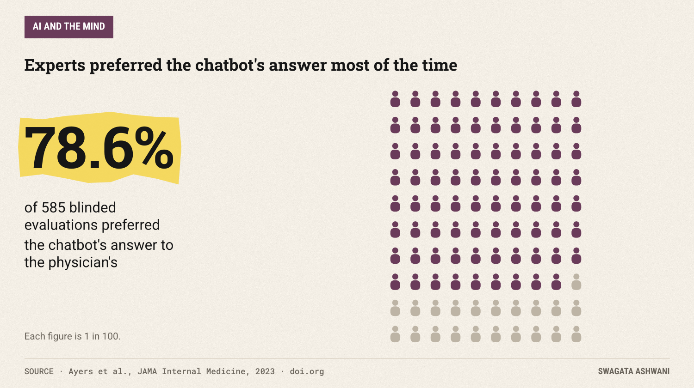

# We say we don't trust AI. Then we stop checking its work

*Decades of research on trusting machines explain the strangest number in AI today.*

Here is a strange pair of numbers. In a survey of more than 48,000 people across 47 countries, only 46% said they're willing to trust AI systems. Yet 66% said they rely on AI's output without checking whether it's accurate ([University of Melbourne and KPMG, 2025](https://kpmg.com/xx/en/our-insights/ai-and-technology/trust-attitudes-and-use-of-ai.html)).

We say we don't trust it. Then we stop checking its work. That contradiction is the heart of decades of research on how people judge machines, and it explains a lot about how we're using AI today.

## The short answer

People don't simply trust or distrust AI. We swing. We often follow a machine's advice *more* readily than a person's, until we see it make a mistake, and then we abandon it far faster than we'd abandon a human who made the same error. Experts trust it less than beginners, sometimes to their cost. And in health care we resist AI even when, by some measures, it does better. The healthiest stance isn't more trust or less trust. It's checking.

## What the world says about trusting AI

The University of Melbourne and KPMG study is the largest look at public trust in AI so far. Its findings show people using AI widely while holding it at arm's length.

Eighty-three percent expect AI to bring a wide range of benefits. Two thirds use it regularly. But fewer than half are willing to trust it, and 70% want it regulated.

The workplace numbers are the most revealing. Sixty-six percent rely on AI output without evaluating its accuracy, and 56% say they're making mistakes in their work because of AI. Saying you distrust a tool and then not checking it is exactly how those mistakes happen.

## Why one mistake costs a machine so much

In 2015, researchers at Wharton described a pattern they called **algorithm aversion** ([Dietvorst, Simmons & Massey, 2015](https://doi.org/10.1037/xge0000033)). Across five studies, people chose between an algorithm and a human forecaster, with real money tied to accuracy.

People who had watched the algorithm make predictions were *less* likely to choose it, even when they'd seen it beat the human.

We forgive people for being imperfect, because that's what people are. We expect machines to be perfect, so one visible error feels like proof the whole thing is broken. The result is that we often walk away from the more accurate option.

## And why we sometimes trust them too much

Four years later, a different team found what looks like the opposite effect ([Logg, Minson & Moore, 2019](https://doi.org/10.1016/j.obhdp.2018.12.005)). Across six experiments, people adjusted their estimates more when they were told the advice came from an algorithm than when it came from a person. They called it **algorithm appreciation**.

The two findings fit together once you see the conditions. Appreciation is strongest when we haven't seen the machine fail and we're weighing its advice against another person's. It fades when we're weighing it against our own judgment, and it fades with expertise. Then comes the twist: experienced professionals relied *less* on the algorithm's advice than lay people did, "which hurt their accuracy."

So beginners may over-trust and experts may under-trust. Neither is checking the evidence; both are going on feel.

## The doctor test

Medicine is where this gets personal. In a well known study, licensed health professionals compared answers to 195 real patient questions from an online forum, one written by a doctor and one by ChatGPT, without knowing which was which ([Ayers et al., 2023](https://doi.org/10.1001/jamainternmed.2023.1838)).

They preferred the chatbot's answer in 78.6% of 585 evaluations. They rated 78.5% of the chatbot's answers good or very good in quality, against 22.1% of the doctors'. And they rated 45.1% of the chatbot's answers empathetic or very empathetic, against just 4.6% of the doctors'.

Before anyone fires their GP: the doctors were answering on Reddit in their spare time, and their replies were much shorter (a median of 52 words versus 211). This shows what a chatbot can do with unlimited time and patience, not that it can replace a physician.

Yet patients often don't want it. Research on "resistance to medical AI" found people are reluctant to use AI-provided health care, even when it performs well ([Longoni, Bonezzi & Morewedge, 2019](https://doi.org/10.1093/jcr/ucz013)). The reason is what the authors call **uniqueness neglect**: we worry a machine can't account for *our* particular circumstances. Tellingly, the resistance disappeared when the AI only supported a human doctor's decision instead of replacing it.

")

## So what's really going on?

Put the studies together and a consistent picture of human trust in machines appears:

1. **We judge machines by a perfection standard.** One error and we bail, even when the machine is still better than the alternative.
2. **Before we see errors, we can over-trust.** Especially as beginners, and especially when the alternative is another person's opinion.
3. **Expertise cuts both ways.** Experts check more, but can also dismiss good advice out of pride.
4. **We want a human in the loop for things that feel personal.** Health, money, and anything about *us*.
5. **Stated trust and actual behavior diverge.** People report distrust while relying on outputs they never verify.

## Who is most affected

- **Busy workers.** When you're rushed, "rely without checking" is the default, and that's where the 56% making mistakes come from.
- **Beginners in a field.** They're most likely to over-trust advice they can't evaluate.
- **Experts.** They risk ignoring genuinely better tools after one bad experience.
- **Patients.** They may avoid helpful tools out of a fear that a machine can't see them as individuals.

## What this means for you

- **Swap trust for verification.** Don't ask "do I trust AI?" Ask "how would I know if this is wrong?" and check that.
- **Keep score, not impressions.** One memorable mistake shouldn't decide whether you use a tool. Notice how often it's right over many uses, and compare that with the person or method you'd use instead.
- **Match checking to stakes.** A dinner recipe needs no audit. A contract clause, a medication question or a number going to your boss does.
- **Use AI as a second opinion, not the final word,** especially for health. That's also the setup patients are most comfortable with.
- **If you're an expert, run a fair test.** Try the tool on cases where you already know the answer before you decide it's useless.

## How we researched this

I read the abstracts and results of each paper cited here, from the Journal of Experimental Psychology, Organizational Behavior and Human Decision Processes, JAMA Internal Medicine and the Journal of Consumer Research, plus the University of Melbourne and KPMG global study's official summary. Every number in this issue comes directly from those sources.

Trust, but check. Swagata

## References

1. Gillespie, N., Lockey, S., et al. (2025). *Trust, attitudes and use of Artificial Intelligence: A global study 2025.* University of Melbourne and KPMG. [Link](https://kpmg.com/xx/en/our-insights/ai-and-technology/trust-attitudes-and-use-of-ai.html)
2. Dietvorst, B. J., Simmons, J. P., & Massey, C. (2015). *Algorithm Aversion: People Erroneously Avoid Algorithms after Seeing Them Err.* Journal of Experimental Psychology: General. [Link](https://doi.org/10.1037/xge0000033)
3. Logg, J. M., Minson, J. A., & Moore, D. A. (2019). *Algorithm appreciation: People prefer algorithmic to human judgment.* Organizational Behavior and Human Decision Processes. [Link](https://doi.org/10.1016/j.obhdp.2018.12.005)
4. Ayers, J. W., Poliak, A., Dredze, M., Leas, E. C., Zhu, Z., Kelley, J. B., et al. (2023). *Comparing Physician and Artificial Intelligence Chatbot Responses to Patient Questions Posted to a Public Social Media Forum.* JAMA Internal Medicine. [Link](https://doi.org/10.1001/jamainternmed.2023.1838)
5. Longoni, C., Bonezzi, A., & Morewedge, C. K. (2019). *Resistance to Medical Artificial Intelligence.* Journal of Consumer Research. [Link](https://doi.org/10.1093/jcr/ucz013)
