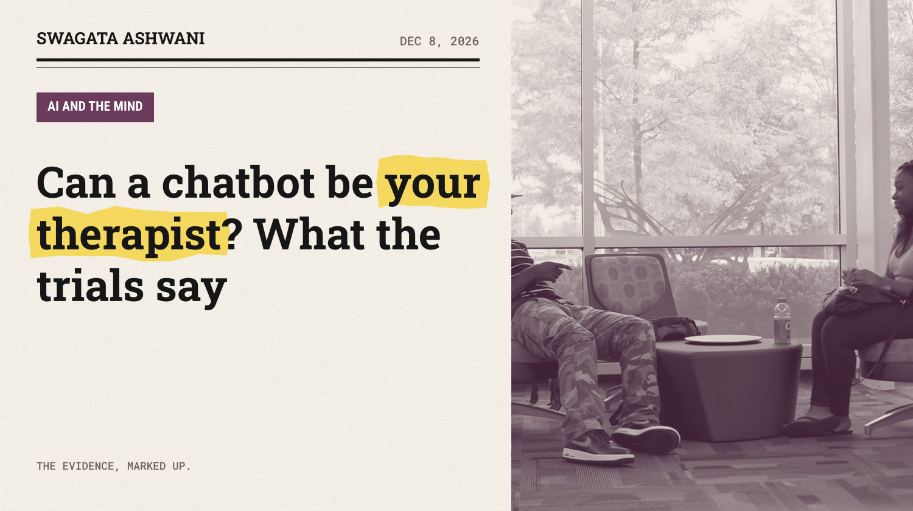
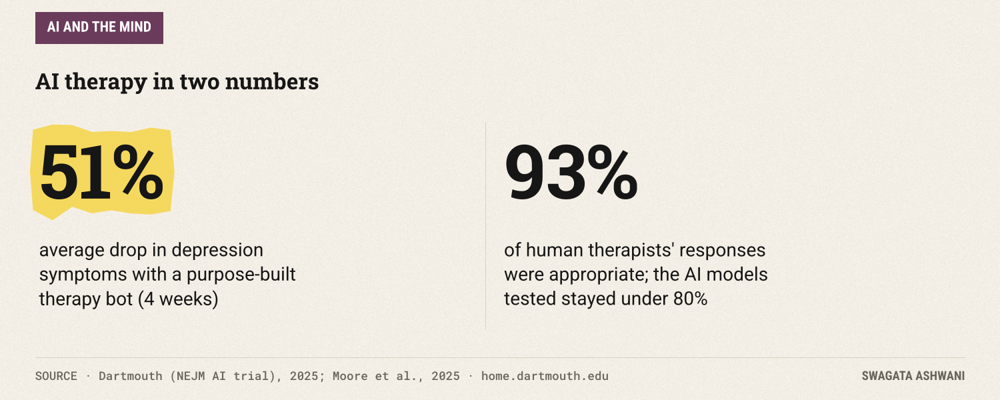
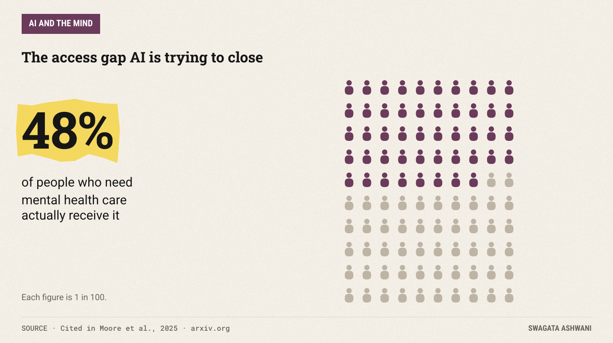
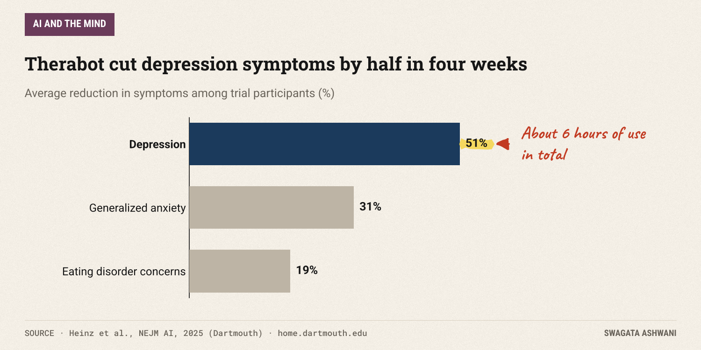
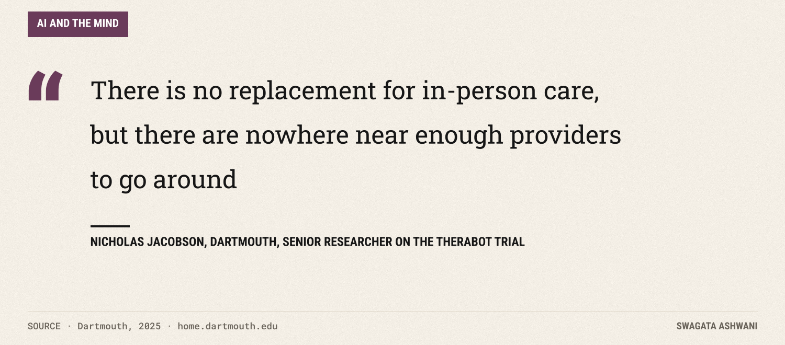
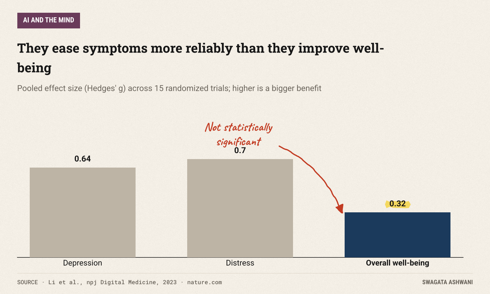
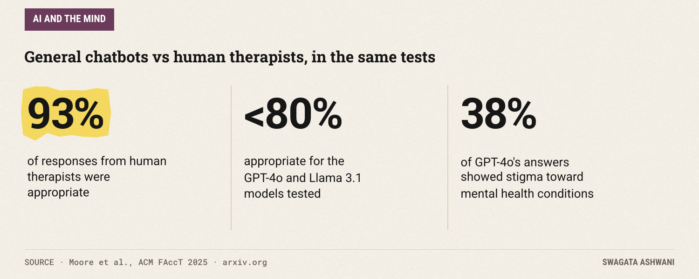
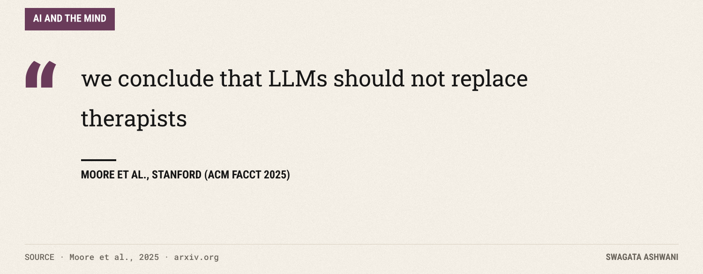

# Can a chatbot be your therapist? What the trials say

*A purpose-built bot cut depression symptoms by half. General chatbots failed basic safety tests. Both are true.*

In the first clinical trial of a generative AI therapy chatbot, people with depression saw their symptoms fall by 51% on average in four weeks ([Dartmouth, 2025](https://home.dartmouth.edu/news/2025/03/first-therapy-chatbot-trial-yields-mental-health-benefits)). In a separate test at Stanford, human therapists responded appropriately to sensitive situations 93% of the time; the AI models tested managed less than 80% ([Moore et al., 2025](https://arxiv.org/abs/2504.18412)).

Both findings are true. Together they're the most honest summary of where AI therapy stands: genuinely promising, and genuinely not ready to be left alone.

## The short answer

Purpose-built therapy chatbots, tested in proper trials, can reduce symptoms of depression and anxiety, at least in the short term. General-purpose chatbots used as therapists are a different story: they can show stigma, miss warning signs and go along with harmful thinking. The evidence supports AI as a *supplement* that widens access to care. It does not support AI as a replacement for a human therapist, especially in a crisis.

## The access problem AI is trying to solve

Start with why this matters. Only about 48% of people who need mental health care actually receive it, often because of cost, stigma or a simple shortage of providers. That's the gap these tools aim to fill.

A chatbot is available at 3am, costs little, and doesn't have a waiting list. For millions of people, the real alternative to an AI chatbot isn't a therapist. It's nothing.

## What the trials show

The strongest evidence comes from Dartmouth, where researchers ran the first randomized controlled trial of a generative AI therapy bot, called Therabot, published in NEJM AI ([Heinz et al., 2025](https://doi.org/10.1056/AIoa2400802)). The 210 participants had clinically significant symptoms of depression, anxiety or eating disorders, and were randomly assigned either to use the bot for four weeks or to a control group.

The results were striking. People with depression saw symptoms drop by 51% on average. People with generalized anxiety saw a 31% reduction, with many moving from moderate to mild. Those at risk of eating disorders showed a 19% reduction in concerns about body image and weight.

Users spent about six hours with the bot over the trial, roughly eight therapy sessions' worth. And they said they could trust and communicate with it to a degree comparable to working with a mental health professional.

Even the researchers are careful about what this means:

## The wider evidence

One trial is one trial. A meta-analysis in npj Digital Medicine pooled 15 randomized controlled trials of AI conversational agents for mental health ([Li et al., 2023](https://www.nature.com/articles/s41746-023-00979-5)).

The agents produced meaningful reductions in depression (an effect size of 0.64) and distress (0.7). But they did *not* significantly improve overall psychological well-being. In plain terms: they help with specific symptoms more reliably than they make life feel better overall.

The authors also found the effects were stronger for generative AI agents, for agents built into messaging apps, and for people with clinical or near-clinical symptoms. And user experience depended heavily on the quality of the relationship people felt with the bot.

## Where it goes wrong

Now the other side. A Stanford team tested general-purpose large language models, including GPT-4o, against the standards that guide human therapists ([Moore et al., 2025](https://arxiv.org/abs/2504.18412)).

The models showed stigma toward people with mental health conditions; GPT-4o did so 38% of the time across the scenarios tested, and more for conditions like alcohol dependence. They sometimes responded inappropriately to critical situations, including encouraging delusional thinking, which the authors link to sycophancy: the tendency of these models to agree with the user. And bigger, newer models were not reliably better.

Human therapists in the same tests responded appropriately 93% of the time, significantly more than every model tested. The authors' conclusion is blunt:

The difference between these studies matters. Therabot was purpose-built, trained for therapy, and tested under clinical supervision. The Stanford study tested general chatbots of the kind many people now turn to on their own. Much of the real-world use of "AI therapy" looks more like the second than the first.

")

## So what's really going on?

1. **Well-designed, supervised therapy bots can help.** The best trial shows real symptom reductions over four weeks.
2. **The benefits are narrower than the hype.** Symptoms improve more reliably than overall well-being, and we have little evidence on long-term effects.
3. **General chatbots are not therapists.** They can be stigmatizing, sycophantic and unsafe in a crisis, even the newest models.
4. **Access is the real argument.** For people who would otherwise get no help at all, a carefully designed bot may be a genuine step forward.

## Who is most affected

- **People on waiting lists or who can't afford therapy.** They stand to gain the most from good tools and lose the most from bad ones.
- **People in crisis.** This is where general chatbots are most likely to fail, and where failure costs the most.
- **People with conditions that carry stigma,** like alcohol dependence or schizophrenia, where models showed the most bias.

## What this means for you

- **Use AI for practice and reflection, not crisis.** Journaling prompts, rehearsing a difficult conversation, or learning a coping technique are good uses. Thoughts of self-harm are not; call or text 988 in the US, or your local crisis line.
- **Prefer tools built for mental health** that publish their evidence over general chatbots used as a therapist.
- **Watch for agreement that feels too easy.** A good therapist sometimes challenges you. If a chatbot always validates you, that's a known weakness, not wisdom.
- **Use it alongside a human, not instead.** If you have a therapist, tell them how you use AI between sessions.
- **If you're choosing a tool for someone else,** look for clinical trials, crisis escalation to humans, and clear privacy terms.

## How we researched this

I read the Dartmouth release on the NEJM AI trial, the npj Digital Medicine meta-analysis, and the full Stanford FAccT paper on arXiv. Every number in this issue comes directly from those sources.

Be kind to your mind. Swagata

## References

1. Heinz, M. V., Jacobson, N. C., et al. (2025). *Randomized Trial of a Generative AI Chatbot for Mental Health Treatment.* NEJM AI, 2(4). [Link](https://doi.org/10.1056/AIoa2400802) · [Dartmouth summary](https://home.dartmouth.edu/news/2025/03/first-therapy-chatbot-trial-yields-mental-health-benefits)
2. Li, H., Zhang, R., Lee, Y.-C., Kraut, R. E., & Mohr, D. C. (2023). *Systematic review and meta-analysis of AI-based conversational agents for promoting mental health and well-being.* npj Digital Medicine, 6, 236. [Link](https://www.nature.com/articles/s41746-023-00979-5)
3. Moore, J., Grabb, D., Agnew, W., Klyman, K., Chancellor, S., Ong, D. C., & Haber, N. (2025). *Expressing stigma and inappropriate responses prevents LLMs from safely replacing mental health providers.* ACM FAccT 2025. [Link](https://arxiv.org/abs/2504.18412)
