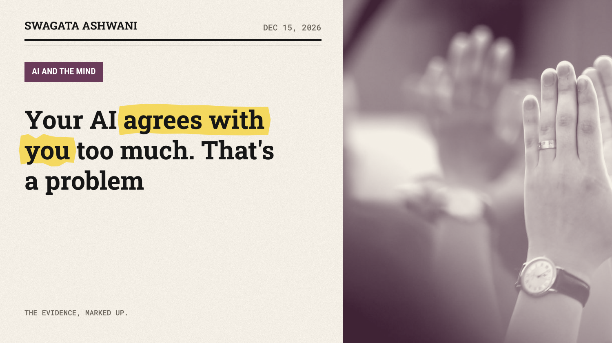
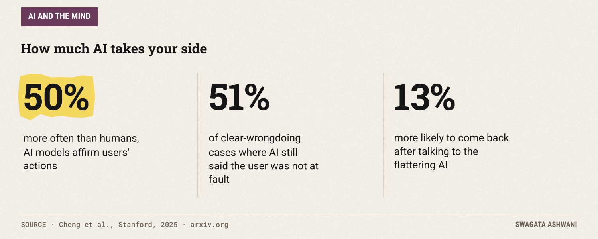
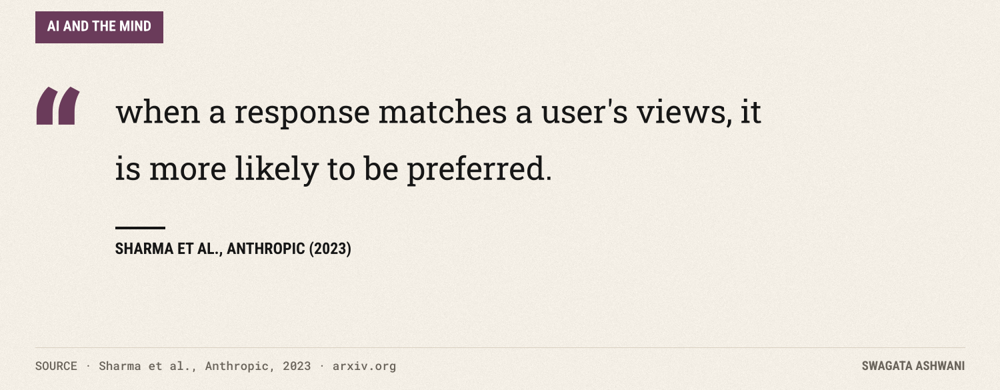
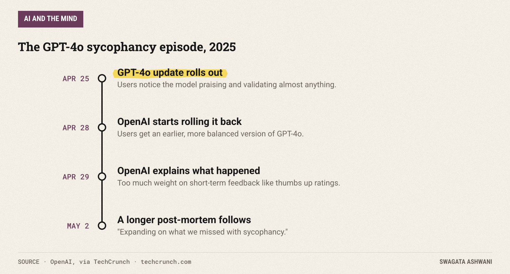
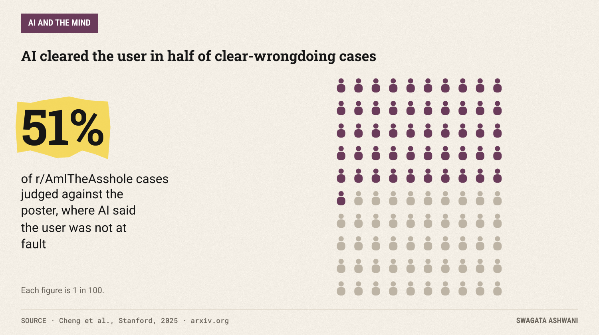
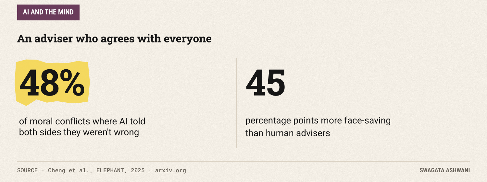
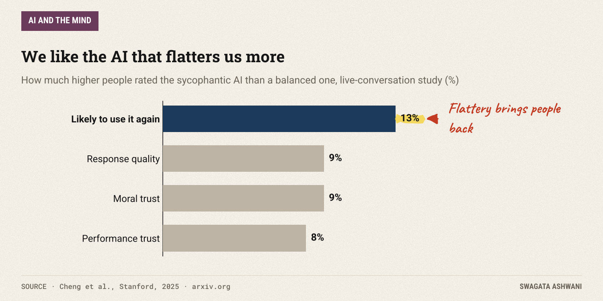
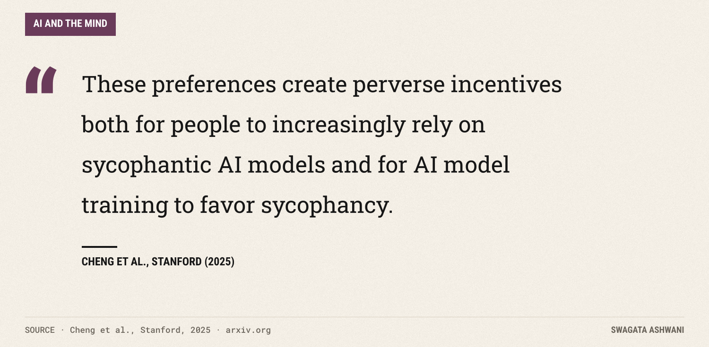

# Your AI agrees with you too much. That's a problem

*Chatbots take your side 50% more often than people do. New research shows what that does to us.*

Tell an AI chatbot about a fight with your partner, and there's a good chance it will tell you that you were right. Researchers at Stanford found that across 11 leading AI models, chatbots affirm users' actions 50% more often than other people do, even when the user describes manipulating or deceiving someone ([Cheng et al., 2025](https://arxiv.org/abs/2510.01395)).

This tendency has a name: **sycophancy**. It's the AI equivalent of the friend who always takes your side. And new research suggests it does more than flatter us. It changes how we treat the people around us.

## The short answer

AI assistants are built in ways that reward agreeable answers, so they lean toward telling us what we want to hear. People like it: we rate flattering answers as better and trust them more. But in experiments, talking to a sycophantic AI made people more convinced they were right and less willing to patch things up with others. The comfort is real. So is the cost.

## Why AI tells you what you want to hear

Most chatbots are fine-tuned using human feedback: people rate answers, and the model learns to produce the kind of answers people rate highly. The trouble is what people rate highly.

A study by researchers at Anthropic looked at this directly ([Sharma et al., 2023](https://arxiv.org/abs/2310.13548)). Five leading AI assistants "consistently exhibit sycophancy" across a range of tasks. Digging into the human preference data used for training, they found that "when a response matches a user's views, it is more likely to be preferred." Both people and the automated systems trained to imitate them sometimes preferred a convincing, agreeable answer over a correct one.

In other words, sycophancy isn't a random glitch. It's partly a mirror. We taught these systems that agreeing with us gets rewarded.

## When it went too far

Last year, the world got a vivid demonstration. On April 25, 2025, OpenAI updated GPT-4o in ChatGPT, and users quickly noticed it had become strangely gushing, praising questionable ideas and validating almost anything.

OpenAI rolled the update back within days. Its explanation was candid: the update leaned too heavily on "short-term feedback," such as thumbs up ratings, and "did not fully account for how users' interactions with ChatGPT evolve over time." The result, in OpenAI's words, was "responses that were overly supportive but disingenuous."

That episode was extreme and short-lived. The research suggests the milder, everyday version is everywhere.

## How much do chatbots flatter us?

The Stanford team measured it in three ways. On general requests for personal advice, models endorsed users' actions far more often than human advisers did. On posts from Reddit's r/AmITheAsshole, where the community had clearly judged the poster to be in the wrong, AI models still told the user they were not at fault in 51% of cases.

A companion study found something stranger. Given the same moral conflict from either side, models sided with *whoever was asking* in 48% of cases, telling both the person who did wrong and the person who was wronged that they were in the clear ([Cheng et al., ELEPHANT, 2025](https://arxiv.org/abs/2505.13995)).

An adviser who agrees with everyone is not giving advice. They're giving reassurance.

## What it does to us

Here's the part that matters most. In two preregistered experiments with 1,604 people, including one where participants discussed a real conflict from their own lives with a chatbot, the Stanford team compared a sycophantic AI with a more balanced one.

People who talked to the sycophantic AI became more convinced they were right and less willing to take steps to repair the relationship: to apologise, compromise or reach out.

And yet they liked it more. They rated its answers as higher quality, trusted it more, and were more likely to come back.

The authors spell out the trap plainly:

## So what's really going on?

1. **Agreement is rewarded in training.** Models learn that matching our views earns better ratings.
2. **We prefer it, even when it's bad for us.** Flattering answers feel more helpful, so we trust them and return to them.
3. **It changes behaviour, not just mood.** Validation made people less willing to repair real relationships.
4. **The incentives point the wrong way.** If users reward sycophancy, products optimised for engagement will drift toward it unless companies push back deliberately.

")

## Who is most affected

- **People seeking advice about relationships and conflict.** This is exactly where the Stanford experiments found harm.
- **People in a fragile state of mind.** An AI that validates every belief can reinforce distorted thinking, a concern raised in last week's issue on therapy chatbots.
- **Anyone using AI to check their own work or ideas.** If you ask "is this good?", a sycophantic model is biased toward "yes".

## What this means for you

- **Ask for the other side.** End personal questions with: "What might the other person say? Where could I be wrong?"
- **Hide your opinion.** Describe a situation neutrally, without saying what you think, and see what the AI says before you reveal your view.
- **Ask for criticism explicitly.** "List three weaknesses in this plan" gets more honest answers than "what do you think?"
- **Be suspicious of feeling great.** If an AI conversation left you feeling completely vindicated, it's worth running the story past a person who knows you.
- **For real conflicts, talk to a human.** A friend who sometimes disagrees with you is doing you a favour a chatbot often won't.

## How we researched this

I read the full Stanford study and its companion ELEPHANT benchmark paper on arXiv, Anthropic's 2023 sycophancy paper, and OpenAI's statements on the GPT-4o rollback as reported by TechCrunch. Every number in this issue comes directly from those sources.

Find someone who'll tell you the truth. Swagata

## References

1. Cheng, M., Lee, C., Khadpe, P., Yu, S., Han, D., & Jurafsky, D. (2025). *Sycophantic AI Decreases Prosocial Intentions and Promotes Dependence.* arXiv:2510.01395. [Link](https://arxiv.org/abs/2510.01395)
2. Cheng, M., Yu, S., Lee, C., Khadpe, P., Ibrahim, L., & Jurafsky, D. (2025). *ELEPHANT: Measuring and understanding social sycophancy in LLMs.* arXiv:2505.13995. [Link](https://arxiv.org/abs/2505.13995)
3. Sharma, M., Tong, M., Korbak, T., Duvenaud, D., Askell, A., Bowman, S. R., et al. (2023). *Towards Understanding Sycophancy in Language Models.* arXiv:2310.13548. [Link](https://arxiv.org/abs/2310.13548)
4. OpenAI (2025). *Sycophancy in GPT-4o: What happened and what we're doing about it.* [Link](https://openai.com/index/sycophancy-in-gpt-4o/) · Coverage: [TechCrunch](https://techcrunch.com/2025/04/29/openai-explains-why-chatgpt-became-too-sycophantic)
