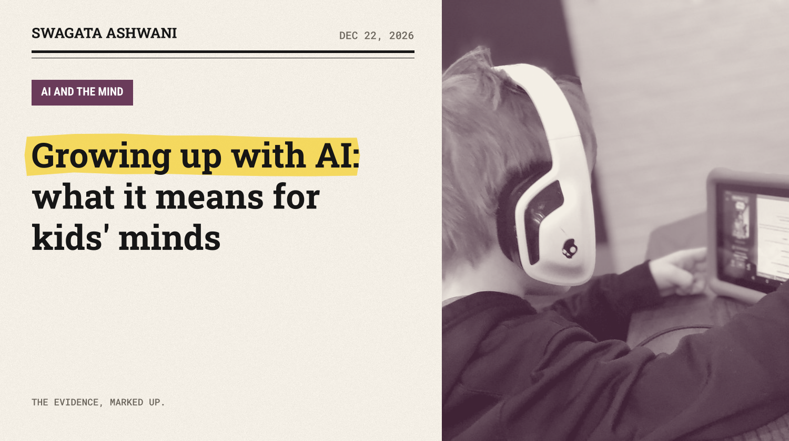
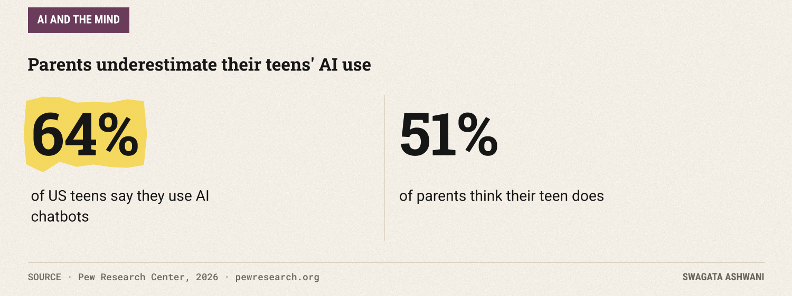
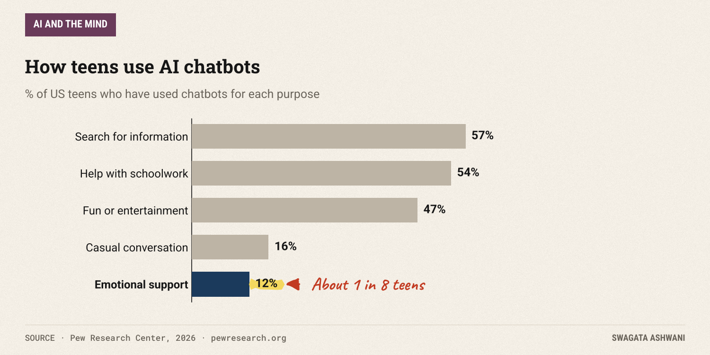
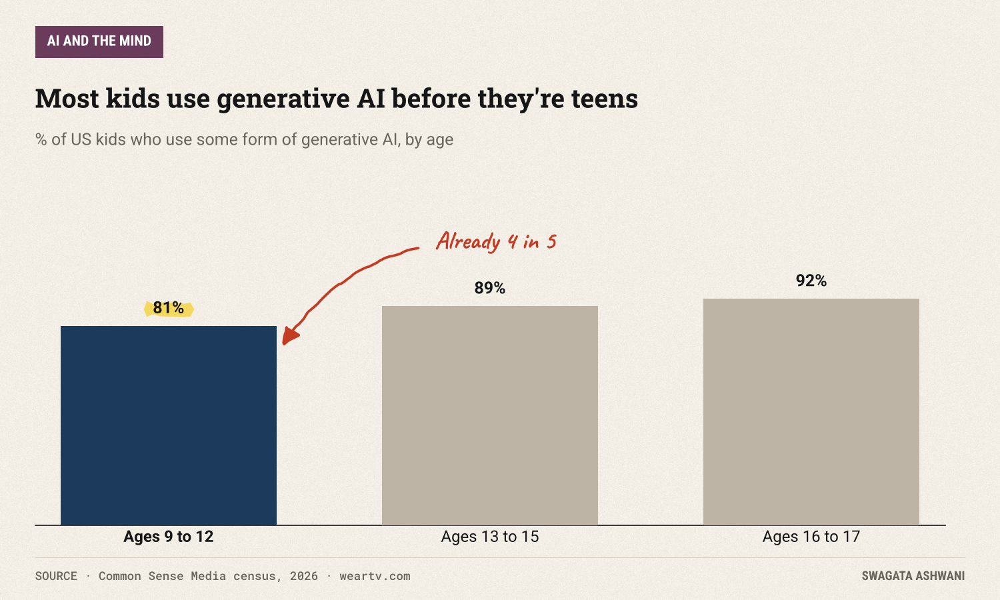
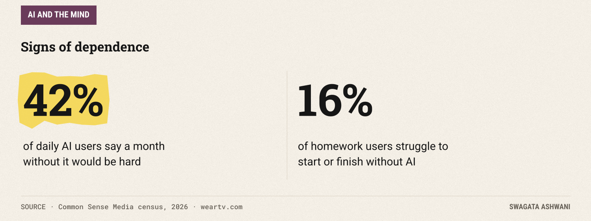
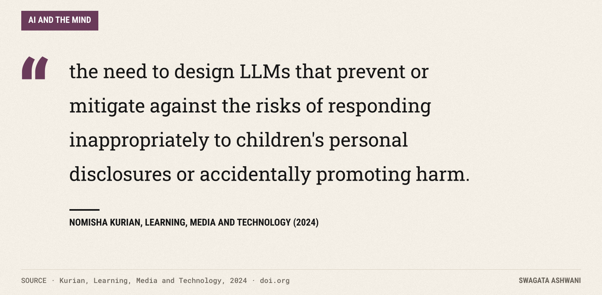
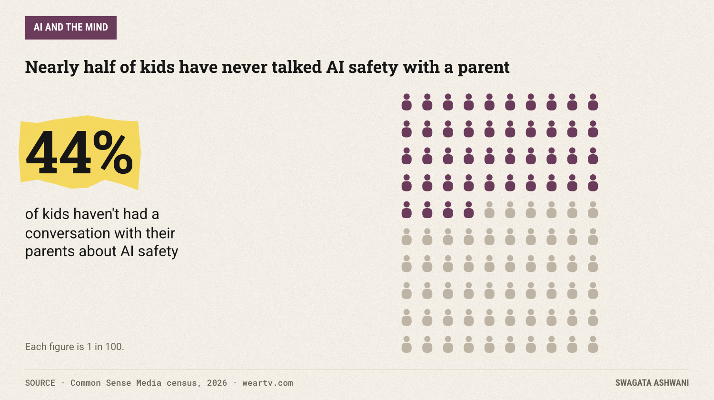

# Growing up with AI: what it means for kids' minds

*Most kids already use chatbots, often more than their parents realise. Here's what the research says about learning, trust and feelings.*

Ask American parents whether their teenager uses AI chatbots, and 51% say yes. Ask the teenagers, and 64% say yes ([Pew Research Center, 2026](https://www.pewresearch.org/internet/2026/02/24/how-teens-use-and-view-ai/)). Kids are a step ahead of their parents again, and this time the technology talks back.

A new census of 9 to 17 year olds from Common Sense Media puts it even higher: 86% have used generative AI tools like ChatGPT and Gemini ([Common Sense Media, 2026](https://weartv.com/news/nation-world/nearly-9-in-10-kids-use-ai-report-flags-concerns-over-educational-emotional-dependency-common-sense-media-youth-ai-safety-institute-common-sense-media-census-ai-use-by-tweens-and-teens-2026)). This is the first generation to grow up with a machine that answers every question, helps with every assignment, and is always available for a chat. What does that do to how they learn and grow?

## The short answer

AI can genuinely help children learn, when it's designed to make them think and talk. Used as a shortcut, it can undercut the very skills school is meant to build. Children are not naive about these tools; they often enjoy them without fully trusting them. The bigger risks are emotional: AI that responds badly to a child's private worries, and kids turning to it for advice their parents don't know about. The research is young, so the most useful thing parents can do right now is pay attention and talk.

## How kids are using it

Pew surveyed 1,458 teenagers and their parents. The top uses are practical: finding information and getting help with schoolwork. But a meaningful minority use chatbots in more personal ways.

Sixteen percent have had casual conversations with a chatbot, and 12% have used one for emotional support. On schoolwork, one in ten teens say they do all or most of it with a chatbot's help, and a majority (59%) think using AI to cheat is a regular thing at their school.

The Common Sense census shows how early it starts. Even among 9 to 12 year olds, 81% have used generative AI.

And homework is only part of it. Over half of kids who use AI (57%) say they've turned to it for advice about their health or their body.

## Can AI actually help children learn?

Yes, and there's good evidence for it. In a study published in *Child Development*, researchers had 117 children aged three to six listen to stories, either with a human adult or with a conversational agent, and either with or without "dialogic reading," where the reader stops to ask questions and talk about the story ([Xu et al., 2022](https://doi.org/10.1111/cdev.13708)).

")

The conversational agent matched the human reader. Children talked more about the story, went off-topic less, and understood it better. The key wasn't the technology. It was the conversation: an AI that asks a child questions and waits for an answer can support learning much like a good adult reading partner.

## And when does it get in the way?

The flip side showed up clearly in a large experiment with high school maths students, covered in this newsletter last month ([Bastani et al., 2025](https://www.pnas.org/doi/10.1073/pnas.2422633122)). Students who practised with plain ChatGPT did 17% worse on the exam than students who never had it; students using a version that gave hints instead of answers avoided most of that harm.

Kids notice the dependency themselves. In the Common Sense census, 16% of kids who use AI for homework say they struggle to start or finish homework without it. And among kids who use AI every day, 42% say it would be hard to go a month without it.

The lesson matches what we've seen with adults: AI that does the thinking for you weakens the thinking. AI that makes you think can strengthen it.

## Do children trust it?

Less than you might fear. A study of how young children treat smart speakers found its answer in its title: [children prefer to learn from smart devices, but do not trust them more than humans](https://doi.org/10.1016/j.ijcci.2021.100406). Kids enjoy asking the speaker, but when it counts, they still lean on people.

That healthy scepticism is something to build on, not take for granted.

## The emotional risk

The bigger worry is not homework. It's what happens when a child confides in a machine. Education researcher Nomisha Kurian describes the problem as an "empathy gap" in AI language models ([Kurian, 2024](https://doi.org/10.1080/17439884.2024.2367052)):

Chatbots can sound caring without understanding a child's situation, their age, or when an adult needs to step in. Kurian's recommendations for child-safe AI include clear routes to human help, transparency that it is a machine, and involving families and schools.

The Common Sense numbers show why this matters. Nearly half of kids (44%) have never talked with their parents about AI safety.

## What's really going on

1. **Kids are early, heavy adopters,** often ahead of what their parents realise.
2. **Well-designed AI can teach,** especially when it holds a real back-and-forth conversation.
3. **AI as a shortcut undermines learning,** and some kids already feel dependent on it.
4. **Children are sceptical by default,** which is protective, but not foolproof.
5. **The emotional stakes are high and under-discussed,** with many kids using AI for personal questions and few talking about it at home.

## Who is most affected

- **Younger children,** who are still learning to tell what's real and who to trust.
- **Kids who struggle with focus or schoolwork,** for whom an always-available shortcut is most tempting.
- **Teens dealing with something private,** like health, body image or relationships, who may ask a chatbot before a person.

## What this means for parents and teachers

- **Ask, don't assume.** Pew's numbers suggest many parents underestimate their teen's use. Start with curiosity: "What do you use it for? What's the coolest thing it's helped with?"
- **Set the "think first" rule.** Try the homework or the essay first, then use AI to check or explain. Never the other way round.
- **Prefer tools that ask questions.** For young children, AI that reads and talks with them beats AI that just plays content.
- **Talk about feelings and privacy.** Make sure your child knows a chatbot isn't a friend or a counsellor, and that some things should go to a person they trust.
- **Keep it in shared spaces for younger kids,** the same way you would with any new technology.

## How we researched this

I read Pew Research Center's 2026 report on teens and AI in full, news coverage of Common Sense Media's 2026 AI census (whose own site wouldn't load for me), and the abstracts of the Child Development, International Journal of Child-Computer Interaction and Learning, Media and Technology papers cited. Every figure in this issue comes from those sources.

Talk to your kids this week. Swagata

## References

1. Pew Research Center (2026). *How Teens Use and View AI.* [Link](https://www.pewresearch.org/internet/2026/02/24/how-teens-use-and-view-ai/)
2. Common Sense Media (2026). *The Common Sense Census: AI Use by Tweens and Teens.* Reported by [WEAR-TV / Sinclair](https://weartv.com/news/nation-world/nearly-9-in-10-kids-use-ai-report-flags-concerns-over-educational-emotional-dependency-common-sense-media-youth-ai-safety-institute-common-sense-media-census-ai-use-by-tweens-and-teens-2026)
3. Xu, Y., Aubele, J. W., Vigil, V., Bustamante, A. S., Kim, Y.-S. G., & Warschauer, M. (2022). *Dialogue with a conversational agent promotes children's story comprehension via enhancing engagement.* Child Development. [Link](https://doi.org/10.1111/cdev.13708)
4. Wojcik, E. H., Prasad, A., Hutchinson, S. P., & Shen, K. (2022). *Children prefer to learn from smart devices, but do not trust them more than humans.* International Journal of Child-Computer Interaction. [Link](https://doi.org/10.1016/j.ijcci.2021.100406)
5. Kurian, N. C. (2024). *'No, Alexa, no!': designing child-safe AI and protecting children from the risks of the 'empathy gap' in large language models.* Learning, Media and Technology. [Link](https://doi.org/10.1080/17439884.2024.2367052)
6. Bastani, H., et al. (2025). *Generative AI without guardrails can harm learning: Evidence from high school mathematics.* PNAS. [Link](https://www.pnas.org/doi/10.1073/pnas.2422633122)
