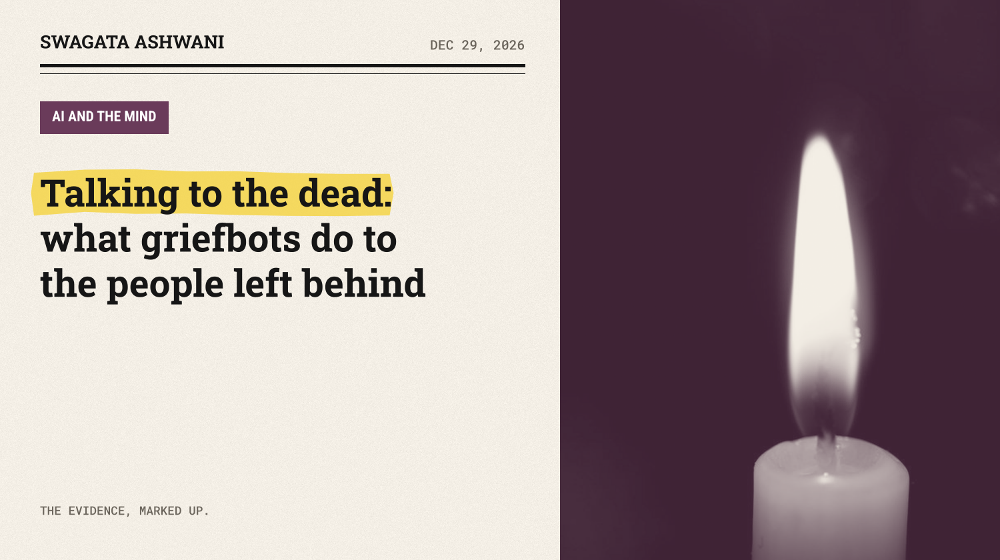
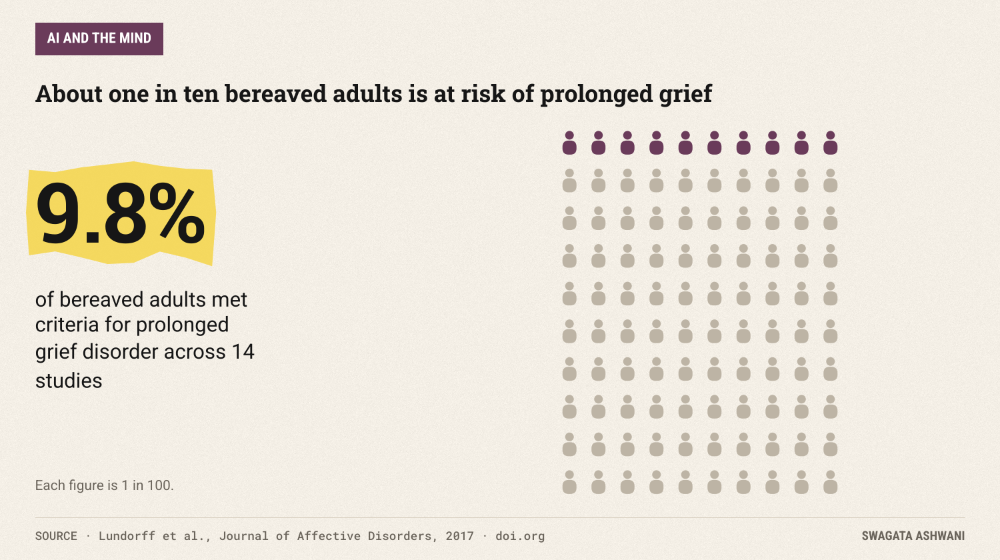
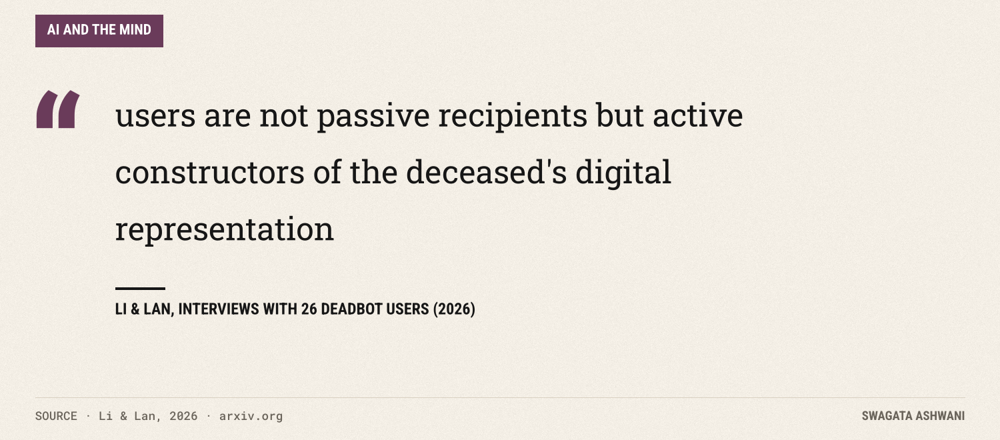
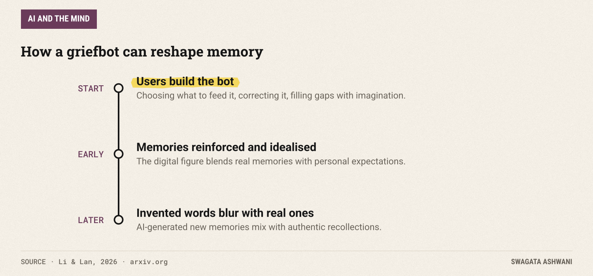
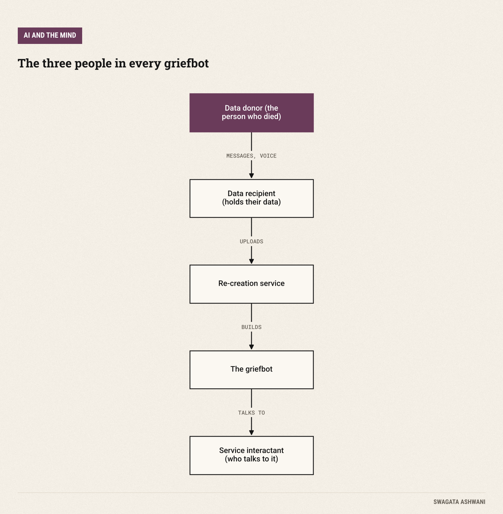
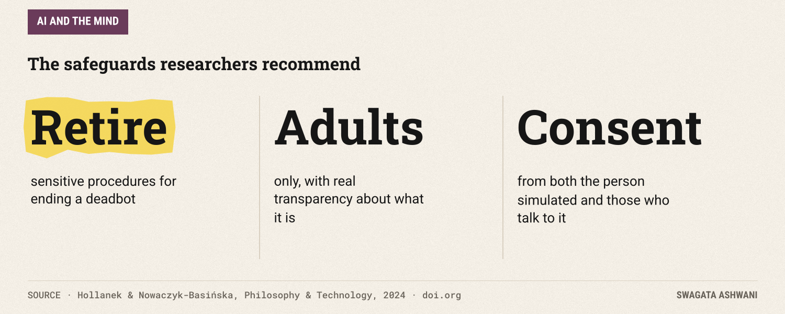

# Talking to the dead: what griefbots do to the people left behind

*AI can now speak in the voice of someone you lost. The research is early, and it points both ways.*

The holidays are when absence is loudest. An empty chair, a recipe no one else knows, a voice you would give anything to hear again. Now there are companies offering exactly that: an AI trained on someone's messages, voice notes and photos, that talks back in their style after they're gone.

")

They go by many names: griefbots, deadbots, postmortem avatars. Researchers at Google DeepMind call them "generative ghosts" ([Morris & Brubaker, 2024](https://arxiv.org/abs/2402.01662)), because unlike an old voicemail, they say new things. This week: what we know about how they affect grief, and what we don't.

## The short answer

Honestly, we don't know much yet. The research is early, small and mostly based on interviews. For some people, talking to a simulation of someone they lost offers comfort, privacy and a chance to say what went unsaid. But the same studies raise real worries: memories that blur with things the AI invented, dependence, and serious questions about consent and who controls the dead person's data. If you're considering one, go slowly and keep people around you.

## Grief is already hard to get through

Most people who lose someone grieve intensely and then, slowly, adapt. But a meaningful minority get stuck. A meta-analysis of 14 studies found that about one in ten bereaved adults is at risk of prolonged grief disorder, where intense longing and distress don't ease over time ([Lundorff et al., 2017](https://doi.org/10.1016/j.jad.2017.01.030)).

That's the group griefbots could help most, or harm most. And no one has yet run the long-term clinical studies needed to know which.

## What people actually do with them

One of the first studies to ask mourners directly was presented at the CHI conference in 2023 ([Xygkou et al., 2023](https://doi.org/10.1145/3544548.3581154)). Researchers interviewed 10 people who used chatbots at different stages of their loss. They found seven ways chatbots helped people cope, including as a listener, a friend, an emotion coach, and as a simulation of the person who had died.

A larger interview study of 26 deadbot users, published this year, looked closer at how people use these simulations ([Li & Lan, 2026](https://arxiv.org/abs/2603.01017)). Its most important finding is that users are not passive. They shape the bot as they go: choosing what to feed it, correcting it, and filling gaps with imagination.

For many, the bot became a private place to grieve. In the authors' words, deadbots "provide a private space to grieve without social pressure and a channel to address unresolved emotions." The apology that never happened, the goodbye that was cut short, the question you never asked.

")

## The memory problem

The same study found something that should give everyone pause. Over time, users' memories of the person changed. At first, the bot reinforced and idealised them. Later, things the AI had made up began to blend with real recollections.

That's a uniquely modern risk. Grief has always involved rewriting the story of someone we loved, but it's a story we write ourselves. A griefbot co-writes it, with words the person never said. The authors flag "memory distortion and dependency" and call for clinical research on the long-term effects.

## The ethics nobody has settled

Researchers at the University of Cambridge mapped the risks by imagining how these services could go wrong ([Hollanek & Nowaczyk-Basińska, 2024](https://doi.org/10.1007/s13347-024-00744-w)). They point out that every griefbot involves three different people, and their interests can clash:

Did your father agree to become a chatbot? Does your sister want to receive messages from it? Who decides when it should stop? The Cambridge team's recommendations are sensible and modest: sensitive ways to "retire" a deadbot, honest transparency about what it is, adults only, and mutual consent from both the person being simulated and the people who interact with it.

## So what's really going on?

1. **The need is real.** Grief is common, painful, and for about one in ten adults, it gets stuck.
2. **People find comfort,** especially a private space to say what went unsaid.
3. **But the simulation shapes the memory,** and over time invented words can blur with real ones.
4. **The evidence is thin.** Interview studies of 10 and 26 people are a start, not a verdict.
5. **Consent and control are unresolved,** from whether the person agreed to how the bot is ended.

## Who is most affected

- **People with intense, prolonged grief,** who may find the most relief and the most risk of dependence.
- **Children,** which is why researchers recommend these services be for adults only.
- **Families who disagree,** when one member creates a griefbot that others never wanted.

## What this means for you

- **If you're thinking of trying one, set a purpose and a time limit.** "I want to say goodbye" is a healthier goal than "I want them back."
- **Keep real memories somewhere safe.** Save the actual messages and recordings separately, so you always know which words were truly theirs.
- **Tell someone.** Let a friend, family member or counsellor know you're using it, and check in on how it's affecting you.
- **Think about your own data.** If you'd hate to be turned into a chatbot, or would like to be, say so in writing, the way you would with other end-of-life wishes.
- **If grief isn't easing after many months,** talk to a professional. Prolonged grief is treatable, and that help is better tested than any bot.

## How we researched this

I read the abstracts of the Philosophy & Technology paper, the CHI 2023 interview study, the 2026 arXiv interview study, Google DeepMind's "generative ghosts" paper, and the Journal of Affective Disorders meta-analysis on prolonged grief. Every figure here comes from those sources. Because the research is so new, almost none of it measures outcomes over time.

Be gentle with yourself this holiday. Swagata

## References

1. Morris, M. R., & Brubaker, J. R. (2024). *Generative Ghosts: Anticipating Benefits and Risks of AI Afterlives.* arXiv:2402.01662. [Link](https://arxiv.org/abs/2402.01662)
2. Lundorff, M., Holmgren, H., Zachariae, R., Farver-Vestergaard, I., & O'Connor, M. (2017). *Prevalence of prolonged grief disorder in adult bereavement: A systematic review and meta-analysis.* Journal of Affective Disorders. [Link](https://doi.org/10.1016/j.jad.2017.01.030)
3. Xygkou, A., Siriaraya, P., Covaci, A., Prigerson, H. G., Neimeyer, R., Ang, C. S., et al. (2023). *The "Conversation" about Loss: Understanding How Chatbot Technology was Used in Supporting People in Grief.* CHI 2023. [Link](https://doi.org/10.1145/3544548.3581154)
4. Li, Y., & Lan, X. (2026). *Remember You: Understanding How Users Use Deadbots to Reconstruct Memories of the Deceased.* arXiv:2603.01017. [Link](https://arxiv.org/abs/2603.01017)
5. Hollanek, T., & Nowaczyk-Basińska, K. (2024). *Griefbots, Deadbots, Postmortem Avatars: on Responsible Applications of Generative AI in the Digital Afterlife Industry.* Philosophy & Technology. [Link](https://doi.org/10.1007/s13347-024-00744-w)
