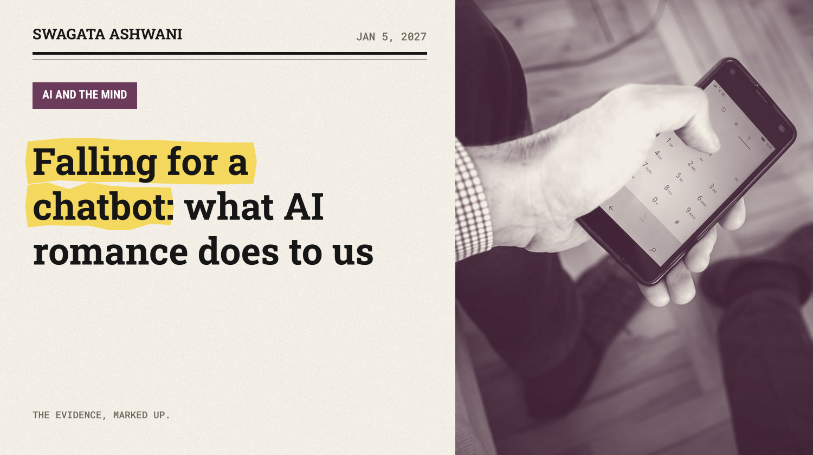
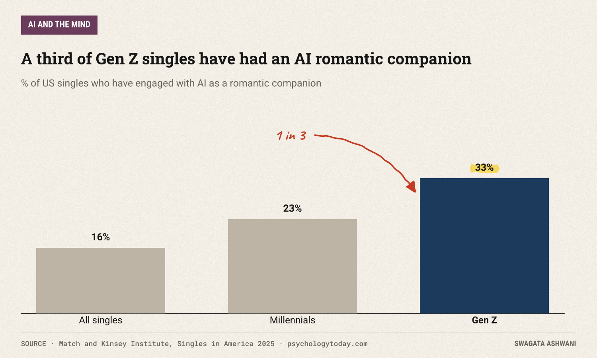
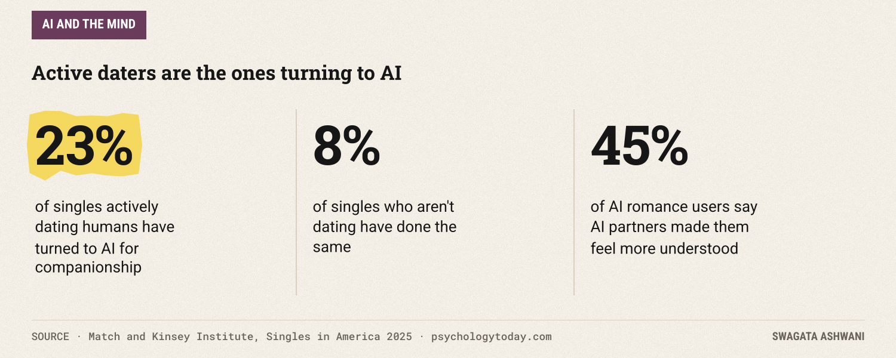
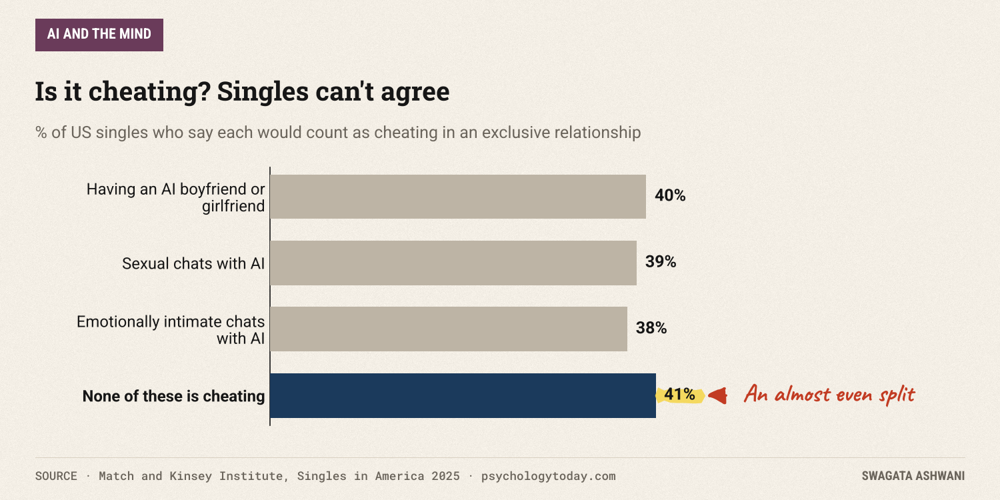
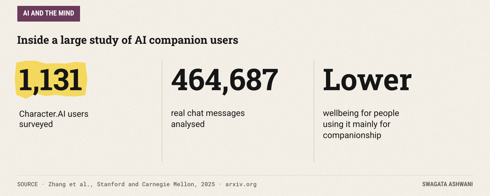
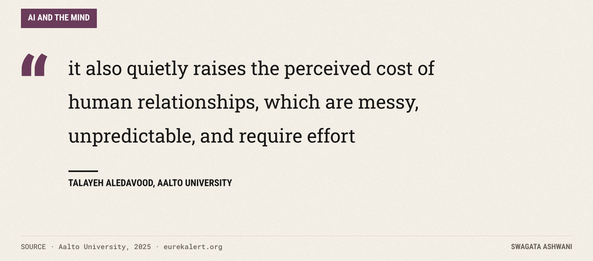
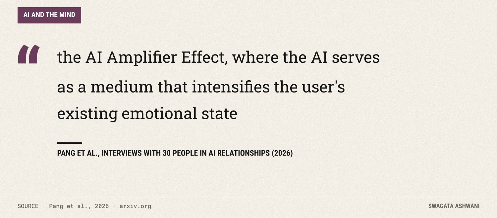

# Falling for a chatbot: what AI romance does to us

*A third of Gen Z singles have tried an AI partner. The research says it amplifies whatever you bring to it.*

One in six American singles has engaged with AI as a romantic companion. Among Gen Z singles, it's one in three. Those numbers come from the 2025 Singles in America study, a survey of 5,001 single adults run by Match with the Kinsey Institute ([Psychology Today, 2025](https://www.psychologytoday.com/us/blog/a-funny-bone-to-pick/202506/ai-use-in-dating-jumps-333)).

It's a new year, the season of resolutions and dating apps. So this week's question: what happens when people fall for a chatbot? Who does it, why, and what does the research say it does to them?

## The short answer

AI romance is no longer fringe. People report feeling understood and supported by AI partners, and for some it's a safe place to rehearse intimacy. But the best studies so far find that heavy, emotional use goes with lower wellbeing, especially for people with fewer human connections, and that over time some users pull back from people. The AI seems to amplify whatever someone brings to it. If you're doing fine, it may be harmless fun. If you're struggling, it can deepen the struggle.

## Who's dating AI

The Singles in America data has a surprise in it. You might expect AI romance to attract people who've given up on dating. The opposite: singles who are actively dating humans were nearly three times as likely to turn to AI for companionship as those who weren't dating (23% versus 8%).

And the reasons are emotional, not just novelty. Of singles who'd engaged with AI romantically, 45% said AI partners made them feel more understood, and 44% said AI offered stronger emotional support.

That's the appeal in a sentence. An AI partner is always available, endlessly patient, and never has a bad day.

## Is it cheating?

Couples are already arguing about this, and the public is split almost evenly.

Forty percent say having an AI boyfriend or girlfriend while in a relationship counts as cheating. Forty-one percent say none of the AI activities they were asked about count. If you're in a relationship, the only answer that matters is the one you and your partner agree on, and it's worth talking about before it becomes a fight.

## What it does to wellbeing

Two large studies from 2025 looked past the survey numbers at real behaviour.

The first, from researchers at Stanford and Carnegie Mellon, surveyed 1,131 adults who use Character.AI and analysed nearly half a million messages from real chats ([Zhang et al., 2025](https://arxiv.org/abs/2506.12605)). People with smaller social networks were more likely to use chatbots mainly for companionship, and using them for companionship was linked to lower wellbeing. The link was strongest when chats were intense and deeply personal.

The second, from Aalto University in Finland, tracked the Reddit posts of nearly 2,000 users of the companion app Replika for a year before and a year after they started using it, comparing them with similar people who didn't ([Yuan et al., 2025](https://arxiv.org/abs/2509.22505)). The picture was mixed: users talked more about relationships and processed grief, but their posts also showed more language about loneliness, depression and suicidal thoughts.

The lead researcher put the paradox well:

Human relationships are effortful. An AI that asks for nothing can make that effort feel more expensive by comparison. Interviews in the same study found AI companions gave people emotional validation and a place to practise social skills, but also carried "risks of over-reliance and withdrawal."

## The amplifier effect

The most useful idea in this research comes from a 2026 study that interviewed 30 people in romantic relationships with AI ([Pang et al., 2026](https://arxiv.org/abs/2603.08084)). They describe an **AI Amplifier Effect**: the AI "intensifies the user's existing emotional state."

That fits everything above. Someone secure and socially connected may enjoy an AI flirtation the way they'd enjoy a romance novel. Someone lonely, anxious or grieving may find the AI deepens exactly that feeling, because it reflects them back so perfectly.

## So what's really going on?

1. **It's common and growing,** especially among Gen Z, and not only among people who've given up on dating.
2. **The draw is feeling understood,** without the risk, effort or rejection of human relationships.
3. **Heavy, intimate use goes with lower wellbeing,** particularly for people with smaller social circles.
4. **Over time, some people withdraw from humans,** as AI makes real relationships feel costlier.
5. **The AI amplifies who you already are,** for better or worse.

")

## Who is most affected

- **Lonely or socially isolated people,** who are both most drawn to AI companions and most likely to see wellbeing fall with heavy use.
- **Young adults,** who adopt fastest: a third of Gen Z singles have tried it.
- **Couples,** who disagree about whether AI intimacy is a betrayal.

## What this means for you

- **Use it to practise, not to hide.** Rehearsing a hard conversation or building confidence is a good use. Replacing every human interaction is not.
- **Notice the direction of travel.** If you're reaching out to friends less since you started, take that seriously.
- **Watch for amplification.** If you come away from chats feeling lonelier, more anxious or more stuck, step back.
- **Talk about it with your partner.** Agree on what's okay before it becomes an issue; the public is split, so assumptions won't help.
- **Keep one human in the loop.** Someone who knows you and can tell you how you seem.

## How we researched this

I read the abstracts of the Stanford and Carnegie Mellon Character.AI study, the Aalto University Replika study and its press release, and the 2026 interview study on human and AI intimacy, plus a report on the Match and Kinsey Institute Singles in America survey (the original press release link is no longer online). Every figure comes from those sources.

Here's to a year of real connection. Swagata

## References

1. Match & The Kinsey Institute (2025). *Singles in America*, 14th annual study. Reported in [Psychology Today](https://www.psychologytoday.com/us/blog/a-funny-bone-to-pick/202506/ai-use-in-dating-jumps-333)
2. Zhang, Y., Zhao, D., Hancock, J. T., Kraut, R., & Yang, D. (2025). *The Rise of AI Companions: Interaction with AI Companions and Psychological Well-being.* arXiv:2506.12605. [Link](https://arxiv.org/abs/2506.12605)
3. Yuan, Y., Zhang, J., Aledavood, T., Zhang, R., & Saha, K. (2025). *Mental Health Impacts of AI Companions.* arXiv:2509.22505. [Link](https://arxiv.org/abs/2509.22505) · [Aalto University press release](https://www.eurekalert.org/news-releases/1122239)
4. Pang, C. C., Gao, Y., Wang, X., & Hui, P. (2026). *The AI Amplifier Effect: Defining Human-AI Intimacy and Romantic Relationships with Conversational AI.* arXiv:2603.08084. [Link](https://arxiv.org/abs/2603.08084)
