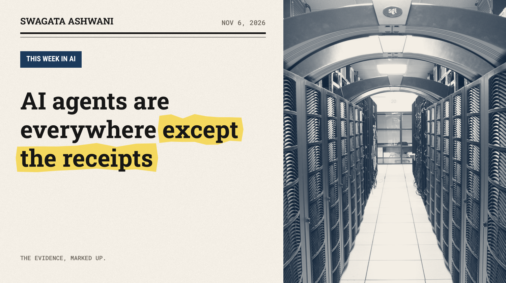
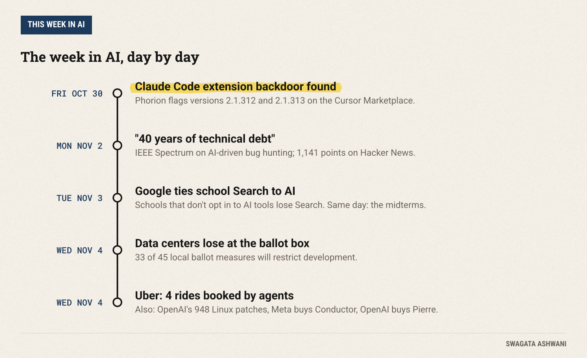
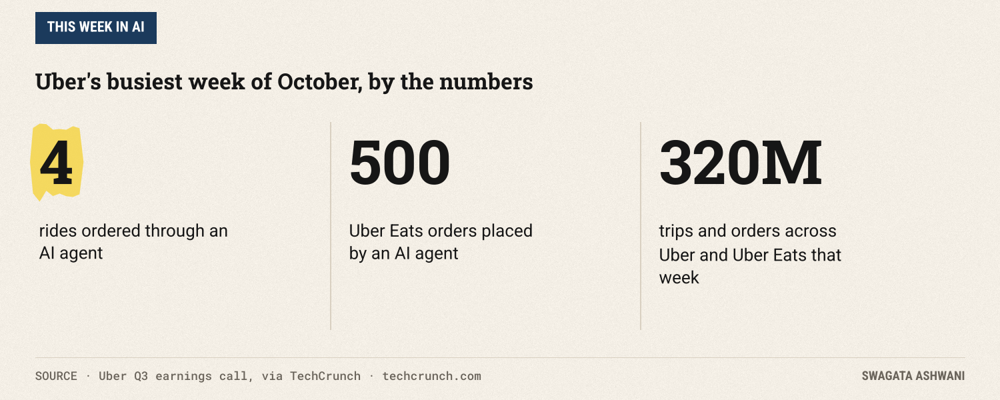
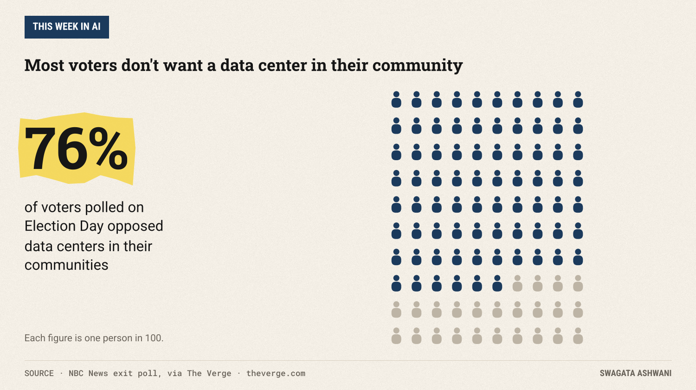

# AI agents are everywhere except the receipts

*Uber's agents booked four rides, AI patched hundreds of Linux holes, and data centers lost the midterms.*

The theme this week: AI agents are everywhere in the pitch decks and almost nowhere in the receipts. Meanwhile, the same technology quietly patched hundreds of security holes in Linux, got smuggled into a backdoor, and lost an election.

## 1. Uber's AI agents booked four rides. Four.

")

On its earnings call on Wednesday, Uber said that during the week of Halloween, its busiest week in October, exactly four rides were ordered through an AI agent. Not four thousand. Four. Uber Eats did better with 500 agent orders, against roughly 320 million trips and orders across both apps that week ([TechCrunch](https://techcrunch.com/2026/11/04/almost-no-one-uses-ai-agents-to-book-their-uber-company-says/)).

CEO Dara Khosrowshahi called it "very, very early and very limited traction." DoorDash told a similar story last week: a few hundred agent orders, total.

**Our take:** the reason is boring and important. Booking a ride in the Uber app takes about 50 seconds. Reordering your usual takes 90. An agent only wins when the task is slow, annoying, or spread across many apps. "Order my usual" is none of those. If you're building agents, pick jobs where the human version is genuinely painful.

**Source:** [TechCrunch](https://techcrunch.com/2026/11/04/almost-no-one-uses-ai-agents-to-book-their-uber-company-says/)

## 2. OpenAI says its AI patched 948 Linux kernel holes

")

OpenAI published "A thousand fewer paths to root," describing an autonomous pipeline that it says found, validated, and generated patches for 948 local privilege-escalation vulnerabilities in the Linux kernel. Those are the bugs that let someone with a foothold on a machine become its administrator.

It lands in the same week as an IEEE Spectrum piece with a headline that sums up the mood among security people: "AI is forcing us to pay off 40 years of technical debt." It was one of the most discussed stories on Hacker News this week, with over 1,100 points.

**Our take:** the attackers have the same tools. When finding bugs gets cheap, the bottleneck moves to the humans who review and ship the fixes. Expect patch volumes to keep climbing, and maintainer burnout to become a security story in its own right. Note that the 948 figure is OpenAI's own count; independent review of the patches will matter.

**Source:** [OpenAI](https://openai.com/index/a-thousand-fewer-paths-to-root) · [IEEE Spectrum](https://spectrum.ieee.org/ai-in-cybersecurity-php2shell-vulnerability)

## 3. A backdoored Claude Code extension hit the Cursor marketplace

")

Security firm Phorion found that the official Claude Code for VS Code extension, as distributed on the Cursor Marketplace, had been compromised. Versions 2.1.312 and 2.1.313 dropped a persistent SSH backdoor on macOS, Linux and Windows. Cursor has pulled both versions ([Phorion](https://phorion.io/blog/offical-claude-code-vsx-compromise/)).

The scary part is the access level. Editor extensions run with your permissions, so a bad one can read your code, your keys and your tools the moment it loads. In a small piece of luck, a bug in the malware's macOS check means it usually fails to switch on SSH for standard users, though it still plants its keys and persistence.

**What to do:** if your team uses Cursor with the Claude Code extension, check for versions 2.1.312 or 2.1.313 and treat any hit as an incident. More broadly, pin extension versions and only install from the publisher's official channel.

**Source:** [Phorion](https://phorion.io/blog/offical-claude-code-vsx-compromise/)

## 4. Google to schools: turn on AI, or lose Search

")

Google announced on Tuesday that schools using its K-12 software won't be able to use Search unless they opt in to its AI tools. "Search and AI are deeply integrated," Google's VP for education told the New York Times ([TechCrunch](https://techcrunch.com/2026/11/04/google-faces-backlash-for-plan-that-would-turn-off-search-for-schools-that-restrict-ai/)).

The backlash was instant and bipartisan in spirit, if not in party. Senator Bernie Sanders called it "extortion." Former FTC chair Lina Khan called it the danger of letting "an unregulated monopolist control an essential service." DuckDuckGo is already pitching itself to schools as the alternative.

**Our take:** this is the first time a tech giant has made AI adoption a condition for a basic service that schools depend on. Whatever you think of AI in classrooms, bundling it this way invites regulators in. Watch for a walk-back or a fight.

**Source:** [TechCrunch](https://techcrunch.com/2026/11/04/google-faces-backlash-for-plan-that-would-turn-off-search-for-schools-that-restrict-ai/)

## 5. Data centers lost the midterms

The AI buildout ran into voters on Tuesday. In NBC News exit polling, 76 percent of voters said they opposed data centers in their communities. There were 45 local ballot measures about data centers across the country, and as of Wednesday morning 33 of them will restrict development ([The Verge](https://www.theverge.com/policy/1026365/data-centers-midterms-results)).

Some results were blunt: several Ohio cities banned data centers over 25MW, and El Dorado, Kansas banned those over 10MW for ten years. In Texas, which has the second-highest number of planned data centers in the country, the new Democratic governor-elect supports a statewide moratorium.

")

**Our take:** compute is now a local politics problem. Power bills, water and noise are concrete; "AI progress" is abstract. The companies that win the next phase may be the ones that figure out how to make a data center a good neighbor, not just a fast one.

**Source:** [The Verge](https://www.theverge.com/policy/1026365/data-centers-midterms-results)

## 6. The coding agent land grab: Meta buys Conductor, OpenAI buys Pierre

")

Meta acquired Conductor, a startup that lets engineers run several AI coding agents in parallel workspaces on different parts of a project ([TechCrunch](https://techcrunch.com/2026/11/04/meta-acquires-ai-coding-startup-conductor/)). The same day, OpenAI announced it will acquire Pierre Computer Company to expand Codex's tools for building, understanding and reviewing code ([OpenAI](https://openai.com/index/openai-to-acquire-pierre)).

If you use Conductor's cloud service, note the date: it shuts down on November 20, and cloud data is deleted after that.

**Our take:** the interesting layer is no longer the model, it's the harness around it: how you split work across agents, review their output and merge it. The big labs are buying that layer rather than waiting to build it.

**Source:** [TechCrunch](https://techcrunch.com/2026/11/04/meta-acquires-ai-coding-startup-conductor/) · [OpenAI](https://openai.com/index/openai-to-acquire-pierre)

## Repos and papers worth a look

")

- **[agent-autoloop](https://github.com/KKKKhazix/agent-autoloop)** (2,802 stars this week): keeps a command-line coding agent working in the background and only interrupts you when it isn't sure. The fastest climber among new AI repos.
- **[uncut](https://github.com/Balanov/uncut)** (601 stars): a minimal coding agent harness in a single 7 MB binary with four tools. A nice antidote to framework bloat.
- **[Advances in Agentic Computer Graphics](https://huggingface.co/papers/2611.01860)** (134 upvotes, the top paper on Hugging Face this week): a survey of agents that write and refine graphics code.
- **[CoworkOS](https://huggingface.co/papers/2611.03178)** (95 upvotes): a harness for long-running "coworker" agents that deliver real artifacts.

## Also worth a look

- OpenAI's [Images 2.6](https://openai.com/index/introducing-images-2-6) can now make animated GIFs.
- Apple is reportedly [cutting budgets](https://techcrunch.com/2026/11/04/apple-is-reportedly-cutting-budgets-for-its-internal-ai-usage/) for its engineers' internal AI usage.
- Nothing's screen-free [AI device](https://techcrunch.com/2026/11/04/nothing-ceo-says-companys-mysterious-ai-first-device-is-dropping-next-month/) launches next month.
- Fujifilm will [boost tape production 5x](https://arstechnica.com/gadgets/2026/10/fujifilm-to-boost-tape-production-5x-as-ai-fuels-archiving-demand/) as AI drives archiving demand. Tape is back.
- A widely discussed [Postman issue](https://news.ycombinator.com/item?id=50354960) alleges the app auto-installs AI plugins without asking.

That's the week. Forward this to the friend who still thinks agents are booking everyone's Ubers. Swagata
