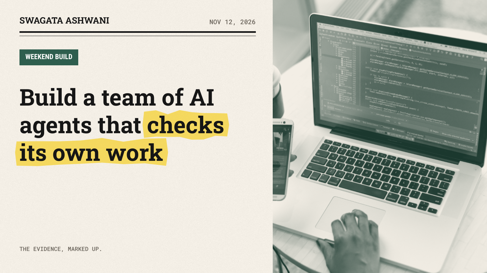
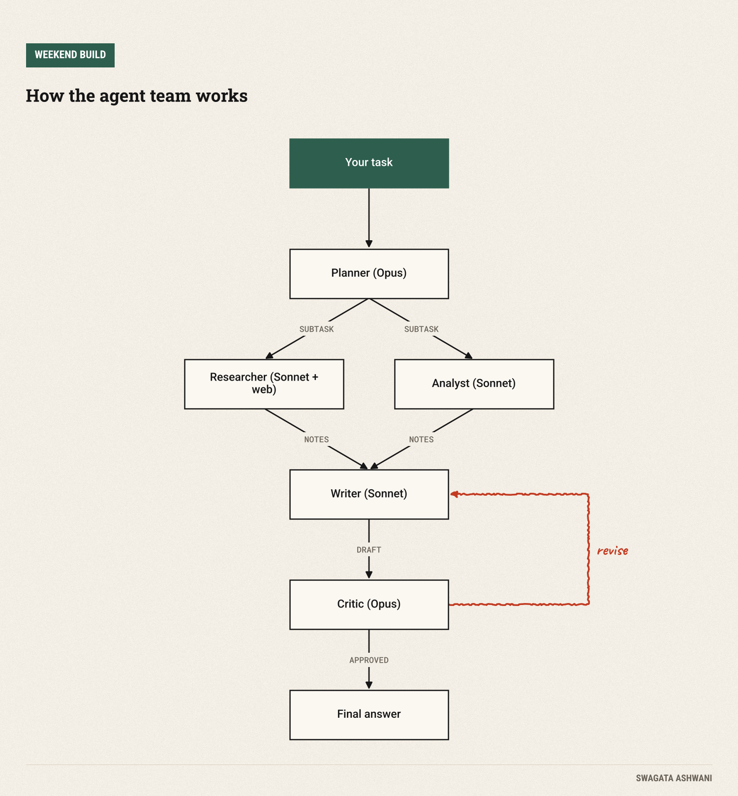
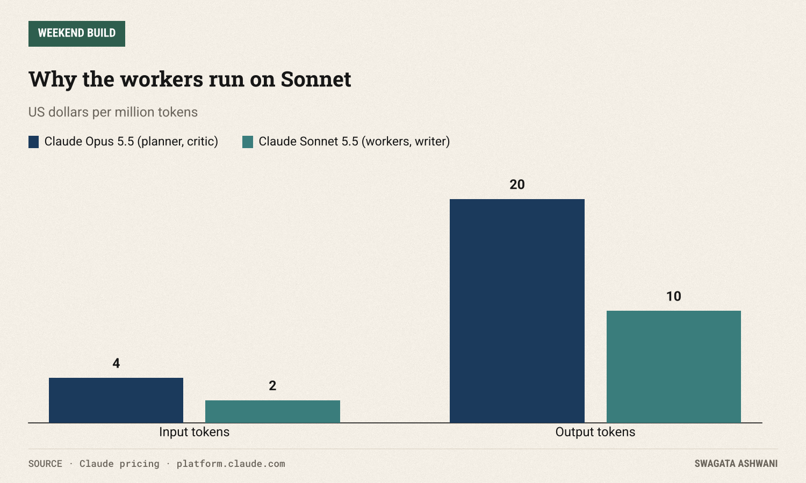
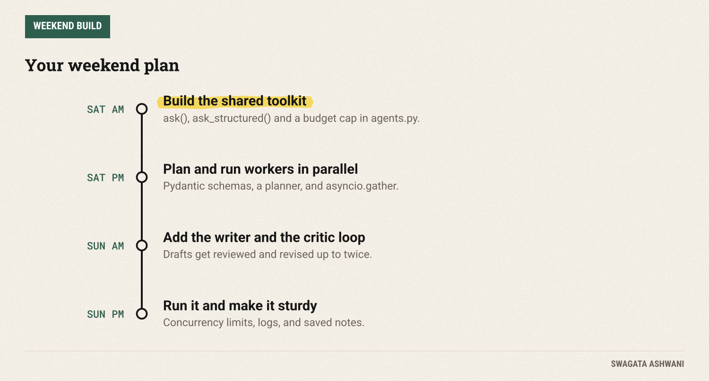

# Build a team of AI agents that checks its own work

*A planner, parallel workers and a tough critic, in about 150 lines of Python. One weekend.*



One AI model answering one question is useful. A small team of them, each with a narrow job, checking each other's work, is something else. By Sunday night you'll have built that team: a planner that breaks a task apart, workers that tackle the pieces in parallel (one of them searching the web), a writer that pulls it together, and a critic that sends it back until it's right.

No framework. About 150 lines of Python on top of the official Anthropic SDK, so you'll understand every moving part.

")

## What you'll build

You give the system a task like "Compare the three most popular open-source vector databases for a small startup." It then:

1. **Plans.** A lead agent splits the task into 2 to 4 independent subtasks and picks a role for each.
2. **Works in parallel.** Researchers search the web and cite sources; analysts reason things through. They all run at the same time.
3. **Writes.** A writer turns the team's notes into one clear answer.
4. **Reviews.** A critic checks the draft against the task. If something is missing or unsourced, it sends specific feedback and the writer revises, up to twice.



The pattern is called orchestrator and workers, and it's the backbone of most serious agent systems. The trick is that each agent sees only what it needs, which keeps them focused and cheap.

## Before you start

You need Python 3.10 or newer and a Claude API key from the [Claude Console](https://platform.claude.com). Then:

```bash
mkdir agent_team && cd agent_team
python -m venv .venv && source .venv/bin/activate
pip install anthropic pydantic
export ANTHROPIC_API_KEY="your-key-here"
```

**Cost.** We use two models on purpose. The planner and critic make judgment calls, so they run on Claude Opus 5.5 ($4 per million input tokens, $20 per million output). The workers and writer do the volume, so they run on Claude Sonnet 5.5, at half the price ([pricing](https://platform.claude.com/docs/en/about-claude/pricing)). Web searches cost $10 per 1,000. A typical run is a few cents, and the code includes a hard budget cap.



## Saturday: the building blocks and the plan

### Step 1: A shared toolkit for every agent

Every agent is just a call to Claude with a different system prompt. So we write the plumbing once. Create `agents.py`:

```python
"""Shared building blocks: one async client, two ways to ask Claude, and a spend tracker."""
import anthropic
from pydantic import BaseModel

LEAD_MODEL = "claude-opus-5-5"      # planner and critic: the judgment calls
WORKER_MODEL = "claude-sonnet-5-5"  # workers: cheaper and faster
PRICES = {LEAD_MODEL: (4.00, 20.00), WORKER_MODEL: (2.00, 10.00)}  # $ per million input / output tokens
BUDGET_USD = 1.00                   # hard stop for a single run

client = anthropic.AsyncAnthropic()  # reads ANTHROPIC_API_KEY from your environment
spent = {"usd": 0.0}

def track(response) -> None:
    """Add this call's token cost to the running total and stop if we blow the budget."""
    price_in, price_out = PRICES[response.model] if response.model in PRICES else PRICES[LEAD_MODEL]
    u = response.usage
    spent["usd"] += (u.input_tokens * price_in + u.output_tokens * price_out) / 1_000_000
    if spent["usd"] > BUDGET_USD:
        raise RuntimeError(f"Budget exceeded: ${spent['usd']:.2f}")

def check(response) -> None:
    if response.stop_reason == "refusal":
        raise RuntimeError("Claude declined this request.")
    if response.stop_reason == "max_tokens":
        raise RuntimeError("Response was cut off; raise max_tokens.")

async def ask(prompt: str, *, system: str, model: str = WORKER_MODEL, web: bool = False) -> str:
    """Ask for plain text. With web=True the agent can search the web (server-side tool)."""
    extra = {"tools": [{"type": "web_search_20260209", "name": "web_search", "max_uses": 5}]} if web else {}
    messages = [{"role": "user", "content": prompt}]
    for _ in range(5):
        response = await client.messages.create(
            model=model, max_tokens=16000, system=system, messages=messages,
            thinking={"type": "adaptive"}, output_config={"effort": "medium"}, **extra,
        )
        track(response)
        if response.stop_reason != "pause_turn":  # long searches pause; send them back to continue
            break
        messages.append({"role": "assistant", "content": response.content})
    check(response)
    return "".join(block.text for block in response.content if block.type == "text")

async def ask_structured(prompt: str, *, system: str, schema: type[BaseModel], model: str = LEAD_MODEL):
    """Ask for an answer that must match a Pydantic schema. Returns a validated object."""
    response = await client.messages.parse(
        model=model, max_tokens=16000, system=system,
        messages=[{"role": "user", "content": prompt}],
        thinking={"type": "adaptive"}, output_config={"effort": "high"},
        output_format=schema,
    )
    track(response)
    check(response)
    return response.parsed_output
```

Three things are worth understanding here:

- **`ask()`** returns plain text. With `web=True` it hands Claude the [web search tool](https://platform.claude.com/docs/en/agents-and-tools/tool-use/web-search-tool), which runs on Anthropic's servers, so there's nothing for you to implement. Long searches can pause; the loop sends the paused turn back so Claude can finish.
- **`ask_structured()`** uses [structured outputs](https://platform.claude.com/docs/en/build-with-claude/structured-outputs): you pass a Pydantic class and get back a validated Python object, never broken JSON. This is how the planner and critic talk to your code.
- **`track()`** adds up the cost of every call and stops the run if it passes `BUDGET_USD`. Agent loops can spend money fast; build the brake on day one.

**Check before moving on:** run `python -c "import asyncio, agents; print(asyncio.run(agents.ask('Say hi in five words.', system='Be brief.')))"`. You should get five words back.

### Step 2: Teach the lead to plan

Now the team itself. Create `team.py` and start with the schemas and the job descriptions:

```python
"""The team: a planner, parallel workers, a writer and a critic."""
import asyncio
from typing import Literal

from pydantic import BaseModel

from agents import LEAD_MODEL, ask, ask_structured

class Subtask(BaseModel):
    role: Literal["researcher", "analyst"]
    instruction: str

class Plan(BaseModel):
    subtasks: list[Subtask]

class Review(BaseModel):
    approved: bool
    feedback: str

PLANNER = """You are the lead of a small research team. Split the user's task into 2 to 4 subtasks
that can be done independently and in parallel. Use "researcher" for anything that needs current
facts from the web, and "analyst" for reasoning, comparison or structuring. Each instruction must
be self-contained: the worker sees only that instruction, not the original task."""

WORKERS = {
    "researcher": {"web": True, "system": "You are a careful researcher. Search the web, use primary "
                   "sources, and put the URL next to every fact. Say so if you could not verify something."},
    "analyst": {"web": False, "system": "You are a sharp analyst. Reason step by step, be concrete, "
                "and state your assumptions."},
}

WRITER = """You write the team's final answer. Use only the notes you are given, keep every source
link, and write clearly for a smart non-expert. Lead with the answer, then the support."""

CRITIC = """You review the team's draft against the original task. Approve it only if it fully answers
the task, every factual claim has a source from the notes, and nothing important is missing.
Otherwise set approved to false and give specific, actionable feedback."""
```

The planner's prompt has one line that matters more than the rest: **each instruction must be self-contained.** Workers never see the original task, only their instruction. That isolation is the point (small, focused contexts), but it means vague instructions produce vague work.

Using `Literal["researcher", "analyst"]` in the schema means the planner can only pick roles that exist. No typos, no invented roles.

### Step 3: Run the workers in parallel

The workers don't depend on each other, so there's no reason to run them one after another. `asyncio.gather` fires them all at once and waits for every result. Here is the whole `run()` function; add it to the bottom of `team.py`. Today, focus on the first half:

```python
async def run(task: str, max_revisions: int = 2, log=print) -> str:
    plan = await ask_structured(f"Task: {task}", system=PLANNER, schema=Plan)
    log(f"Plan: {len(plan.subtasks)} subtasks")
    for s in plan.subtasks:
        log(f"  - [{s.role}] {s.instruction}")

    results = await asyncio.gather(*(
        ask(s.instruction, system=WORKERS[s.role]["system"], web=WORKERS[s.role]["web"]) for s in plan.subtasks
    ))
    notes = "\n\n".join(f"## {s.role}: {s.instruction}\n{r}" for s, r in zip(plan.subtasks, results))
    log("Workers done.")

    draft = await ask(f"Task: {task}\n\nTeam notes:\n{notes}", system=WRITER)
    for attempt in range(1, max_revisions + 1):
        review = await ask_structured(f"Task: {task}\n\nTeam notes:\n{notes}\n\nDraft:\n{draft}",
                                      system=CRITIC, schema=Review, model=LEAD_MODEL)
        if review.approved:
            log(f"Critic approved on round {attempt}.")
            break
        log(f"Critic round {attempt}: {review.feedback[:120]}")
        draft = await ask(f"Task: {task}\n\nTeam notes:\n{notes}\n\nPrevious draft:\n{draft}\n\n"
                          f"Reviewer feedback to fix:\n{review.feedback}", system=WRITER)
    return draft
```

Read it top to bottom: plan, then `gather` the workers, then stitch their results into one notes document labelled by role. We'll come back to the rest of the function tomorrow.

**Check before moving on:** you should be able to see the plan printed with 2 to 4 subtasks when you run it in Step 5.

## Sunday: the critic, the run, and the guardrails

### Step 4: Close the loop with a critic

The back half of `run()`, which you already have above, is where quality comes from. The writer drafts from the notes. Then the critic, on the stronger model, compares the draft with the task and returns a `Review`: approved or not, plus specific feedback. If it's rejected, the writer revises with that feedback in hand. `max_revisions=2` keeps it from looping forever.

Why a separate critic instead of telling the writer to "double check"? Because a fresh reviewer with a narrow brief catches things the author is blind to. That's as true for models as it is for people.

### Step 5: Run your team

Create `main.py`:

```python
"""Run it: python main.py "your task" """
import asyncio
import sys

from agents import spent
from team import run

if __name__ == "__main__":
    task = " ".join(sys.argv[1:]) or "Compare the three most popular open-source vector databases for a small startup."
    answer = asyncio.run(run(task))
    print("\n" + answer)
    print(f"\nCost of this run: ${spent['usd']:.3f}")
```

Then:

```bash
python main.py "What are the best practices for evaluating LLM apps in production?"
```

You'll see the plan, the workers finishing, the critic's verdict on each round, and finally the answer with sources and the cost of the run. Try a few different tasks and watch how the plan changes.



### Step 6: Make it sturdy

Before you trust it with anything real, add three small things:

1. **A concurrency limit.** If the planner ever creates many subtasks, parallel calls can hit rate limits. Wrap worker calls in an `asyncio.Semaphore(4)`.
2. **Logging to a file.** Pass a `log` function to `run()` that writes to disk, so you can read back what each agent did when an answer looks odd.
3. **Saving the notes.** Return `notes` alongside the answer. When the critic rejects something, the notes tell you whether the research or the writing was the problem.

## Common pitfalls

- **Vague subtasks.** If an answer is shallow, look at the plan first. Nine times out of ten the instruction was too vague for a worker who can't see the original task.
- **Forcing tools to get JSON.** On Claude Opus 5.5 you can't force a specific tool call. Use structured outputs, as we do, when you need data back.
- **Ignoring stop reasons.** Always check for `refusal` and `max_tokens` before using a response. The `check()` helper does this for you.
- **Letting it loop.** Every agent loop needs a hard cap on rounds and on money. We have both.
- **One model for everything.** Putting every agent on the most expensive model rarely improves the result. Spend on judgment (planning, reviewing), save on volume.

## Take it further

- **Add roles.** A "coder" worker that writes and explains snippets, or a "skeptic" that looks for counterarguments.
- **Give the critic teeth.** Ask it to list each claim and its source, and reject drafts with unsourced claims.
- **Remember past runs.** Save notes from previous tasks and let the planner reuse them.
- **Test it.** Collect ten tasks with answers you trust and run them after every change. (That's a future Weekend Build.)

## Resources

- [Anthropic Python SDK](https://github.com/anthropics/anthropic-sdk-python)
- [Structured outputs](https://platform.claude.com/docs/en/build-with-claude/structured-outputs)
- [Web search tool](https://platform.claude.com/docs/en/agents-and-tools/tool-use/web-search-tool)
- [Claude pricing](https://platform.claude.com/docs/en/about-claude/pricing)

Have fun building, and reply with what your team made. Swagata
