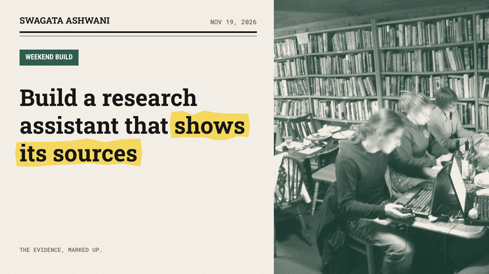
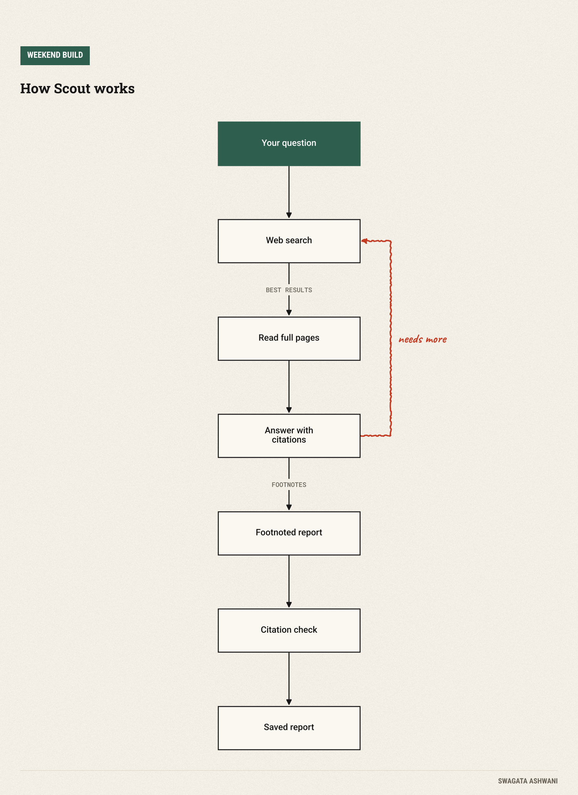
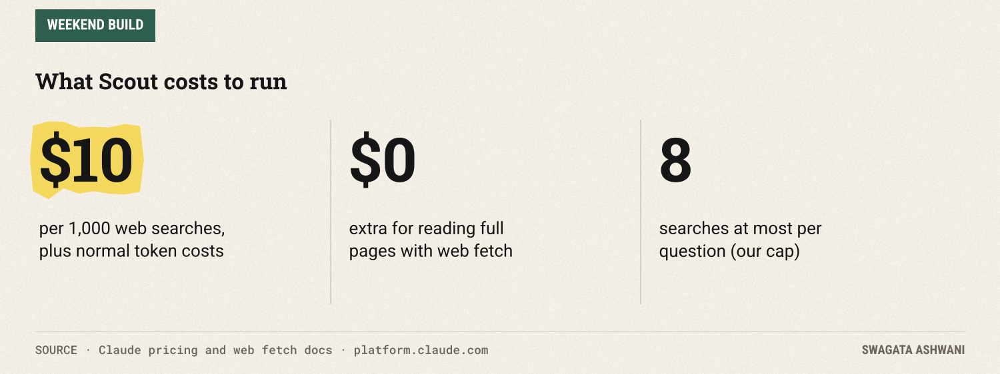
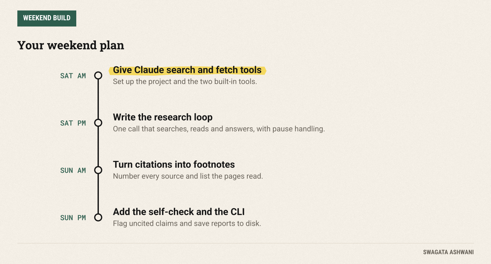

# Build a research assistant that shows its sources

*Scout searches the web, reads the pages and footnotes every claim. One Python file, one weekend.*



Ask a chatbot a factual question and you get a confident paragraph. Ask "where did that come from?" and things get vague. This weekend you'll build the fix: **Scout**, a research assistant that searches the web, reads the actual pages, and puts a numbered source next to every claim. Then it checks its own report for anything it couldn't back up.

It's one Python file, about 100 lines, and you can run it from your terminal on any question you like.

")

## What you'll build

You type a question, for example "Which vector database should a small startup use?", and Scout:

1. **Searches** the web, up to 8 times, choosing its own queries.
2. **Reads** the most promising pages in full, not just the search snippets.
3. **Answers** with a direct conclusion first, then the detail.
4. **Cites** every claim with a numbered footnote that links to the source.
5. **Checks** its own report and lists any claim that isn't backed by a source.

The report is saved as a Markdown file you can share, paste into a doc, or keep as a research log.



The interesting part is how little you have to build. Search and page reading run on Anthropic's servers as built-in tools, and Claude attaches citations to its answer automatically. Your job is to run the loop, collect the pieces, and present them well.

## Before you start

You need Python 3.10+ and a Claude API key from the [Claude Console](https://platform.claude.com).

```bash
mkdir scout && cd scout
python -m venv .venv && source .venv/bin/activate
pip install anthropic
export ANTHROPIC_API_KEY="your-key-here"
```

**Cost.** Scout runs on Claude Sonnet 5.5. Searches cost $10 per 1,000 on top of normal token costs, and reading pages with the web fetch tool costs nothing extra beyond tokens ([pricing](https://platform.claude.com/docs/en/about-claude/pricing), [web fetch docs](https://platform.claude.com/docs/en/agents-and-tools/tool-use/web-fetch-tool)). With at most 8 searches per question, the search fee tops out at 8 cents.



## Saturday: search, read and answer

### Step 1: Give Claude its research tools

Create `scout.py` and start with the setup and the tools:

```python
"""Scout: a research assistant that searches the web, reads pages and cites every claim."""
import argparse
import re
from datetime import date
from pathlib import Path

import anthropic

MODEL = "claude-sonnet-5-5"
client = anthropic.Anthropic()  # reads ANTHROPIC_API_KEY

SYSTEM = """You are a meticulous research assistant. Search the web, open the most authoritative
pages (official sites, papers, primary data) and answer the question. Prefer primary sources over
news coverage. Say clearly when sources disagree or when something could not be verified.
Lead with a direct answer, then the supporting detail. Be concise."""

def tools(only_domains: list[str] | None = None) -> list[dict]:
    search = {"type": "web_search_20260209", "name": "web_search", "max_uses": 8}
    if only_domains:
        search["allowed_domains"] = only_domains
    return [search, {"type": "web_fetch_20260209", "name": "web_fetch", "max_uses": 5}]
```

Two tools do the heavy lifting. [Web search](https://platform.claude.com/docs/en/agents-and-tools/tool-use/web-search-tool) finds pages; web fetch opens one and reads the whole thing. A useful safety detail: Claude can only fetch URLs that have already appeared in the conversation, such as a search result, so it can't wander off to random addresses.

The optional `allowed_domains` setting is a superpower for serious research. Restrict Scout to `arxiv.org,nature.com` and you get answers grounded only in papers.

### Step 2: The research loop

Add the function that does the work:

```python
def research(question: str, only_domains: list[str] | None = None) -> list:
    """Run the search-and-read loop. Returns every content block Claude produced."""
    messages = [{"role": "user", "content": question}]
    blocks = []
    for _ in range(6):
        response = client.messages.create(
            model=MODEL, max_tokens=16000, system=SYSTEM, messages=messages,
            tools=tools(only_domains), thinking={"type": "adaptive"}, output_config={"effort": "medium"},
        )
        blocks += response.content
        if response.stop_reason != "pause_turn":  # long research turns pause; send them back to continue
            break
        messages.append({"role": "assistant", "content": response.content})
    if response.stop_reason == "refusal":
        raise RuntimeError("Claude declined this request.")
    return blocks
```

This is almost the whole agent. Claude decides what to search for, what to read, and when it knows enough, all inside a single API call. The only wrinkle is `pause_turn`: on long research jobs the server pauses partway, and you send the conversation back so it can carry on. We keep every block from every round, because the answer and its citations can arrive across several of them.

**Check before moving on:** in a Python shell, run `import scout; blocks = scout.research("What is the population of Iceland?")` and print `[b.type for b in blocks]`. You should see `server_tool_use`, `web_search_tool_result` and `text` blocks.

## Sunday: citations, self-checks and polish

### Step 3: Turn citations into footnotes

Claude's text comes back in pieces, and each piece can carry a list of citations pointing at the search results it relied on. We number each unique source and append the numbers after the sentence:

```python
def to_markdown(question: str, blocks: list) -> str:
    """Turn Claude's answer and its citations into a report with numbered footnotes."""
    sources: dict[str, tuple[int, str]] = {}  # url -> (number, title)
    pages_read: list[str] = []
    body = []
    for b in blocks:
        if b.type == "web_fetch_tool_result" and b.content.type == "web_fetch_result":
            pages_read.append(b.content.url)
        elif b.type == "text":
            marks = []
            for c in b.citations or []:
                if c.type == "web_search_result_location":
                    if c.url not in sources:
                        sources[c.url] = (len(sources) + 1, c.title or c.url)
                    n = sources[c.url][0]
                    if f"[{n}]" not in marks:
                        marks.append(f"[{n}]")
            body.append(b.text + "".join(marks))
    lines = [f"# {question}", "", f"*Researched {date.today():%B %d, %Y}*", "", "".join(body).strip(), "", "## Sources"]
    lines += [f"{n}. [{title}]({url})" for url, (n, title) in sorted(sources.items(), key=lambda kv: kv[1][0])]
    extra = [u for u in dict.fromkeys(pages_read) if u not in sources]
    if extra:
        lines += ["", "## Also read", *[f"- {u}" for u in extra]]
    return "\n".join(lines) + "\n"
```

The result reads like a proper research note: claims with [1], [2] markers, a numbered source list, and a separate list of pages Scout read in full.

### Step 4: Make Scout check its own work

Even a careful model sometimes slips in a claim from memory. A second, cheap pass catches it:

```python
def check(report: str) -> str:
    """A second, skeptical pass: list any claim in the report that has no footnote."""
    response = client.messages.create(
        model=MODEL, max_tokens=4000, thinking={"type": "adaptive"}, output_config={"effort": "low"},
        messages=[{"role": "user", "content": "List every factual claim in this report that has no "
                   "[number] citation, one per line. If every claim is cited, reply exactly: ALL CITED\n\n"
                   + report}],
    )
    return "".join(b.text for b in response.content if b.type == "text").strip()
```

This is the same idea as an editor reading a draft: a fresh pass with one narrow job. If anything comes back other than `ALL CITED`, the report gets a "Claims to double-check" section at the bottom, so you know exactly where to look.

### Step 5: Run it

The bottom of the file wires everything into a command:

```python
def slug(text: str) -> str:
    return re.sub(r"[^a-z0-9]+", "-", text.lower()).strip("-")[:60]

if __name__ == "__main__":
    p = argparse.ArgumentParser(description="Research a question on the web, with citations.")
    p.add_argument("question")
    p.add_argument("--only", help="Comma-separated domains to search, e.g. arxiv.org,nature.com")
    args = p.parse_args()

    blocks = research(args.question, args.only.split(",") if args.only else None)
    report = to_markdown(args.question, blocks)
    verdict = check(report)
    if verdict != "ALL CITED":
        report += "\n## Claims to double-check\n\n" + verdict + "\n"

    out = Path("reports") / f"{date.today():%Y-%m-%d}-{slug(args.question)}.md"
    out.parent.mkdir(exist_ok=True)
    out.write_text(report)
    print(report)
    print(f"Saved to {out}")
```

Try it:

```bash
python scout.py "What's the evidence that intermittent fasting helps weight loss?"
python scout.py "How do vector databases compare for small teams?" --only qdrant.tech,weaviate.io,milvus.io
```

Each run prints the report and saves it to `reports/`.



## Common pitfalls

- **Trusting snippets.** Search results are short excerpts. For anything important, let Scout fetch the full page; the system prompt nudges it to read primary sources.
- **Too many searches.** More searches isn't better research. `max_uses` caps cost and stops the model from wandering. Raise it only for genuinely broad questions.
- **Ignoring pauses.** Without the `pause_turn` loop, long research jobs quietly stop halfway.
- **Treating citations as proof.** A citation shows where a claim came from, not that the source is right. The `--only` flag is your quality filter.
- **Forgetting the date.** Web answers age fast. The report records when it was researched.

## Take it further

- **Academic mode:** default `--only` to journals and preprint servers for literature reviews.
- **Compare mode:** ask the same question restricted to two different sets of sources and diff the answers.
- **Watchlist:** run Scout every Monday on questions you care about and get the reports by email.
- **Team version:** combine it with last week's agent team, using Scout as the researcher worker.

## Resources

- [Web search tool docs](https://platform.claude.com/docs/en/agents-and-tools/tool-use/web-search-tool)
- [Web fetch tool docs](https://platform.claude.com/docs/en/agents-and-tools/tool-use/web-fetch-tool)
- [Anthropic Python SDK](https://github.com/anthropics/anthropic-sdk-python)
- [Claude pricing](https://platform.claude.com/docs/en/about-claude/pricing)

Happy researching, and send me the best report Scout writes for you. Swagata
