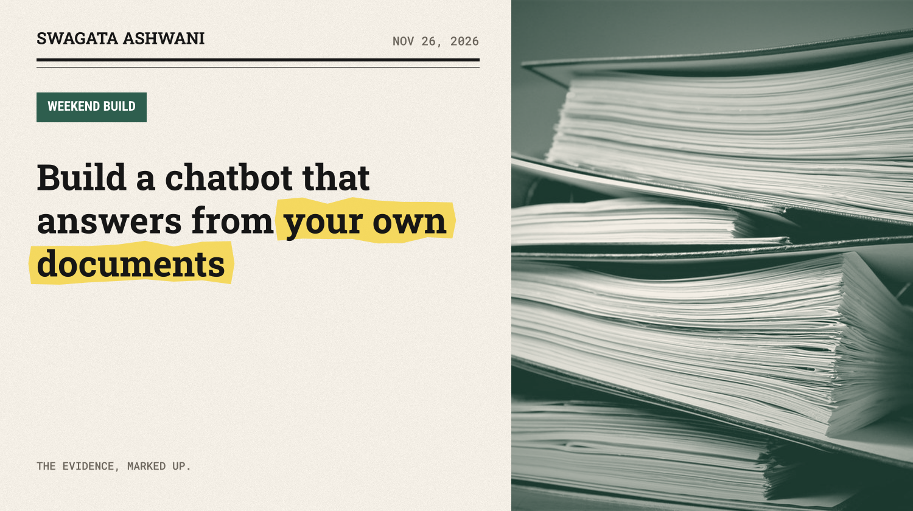
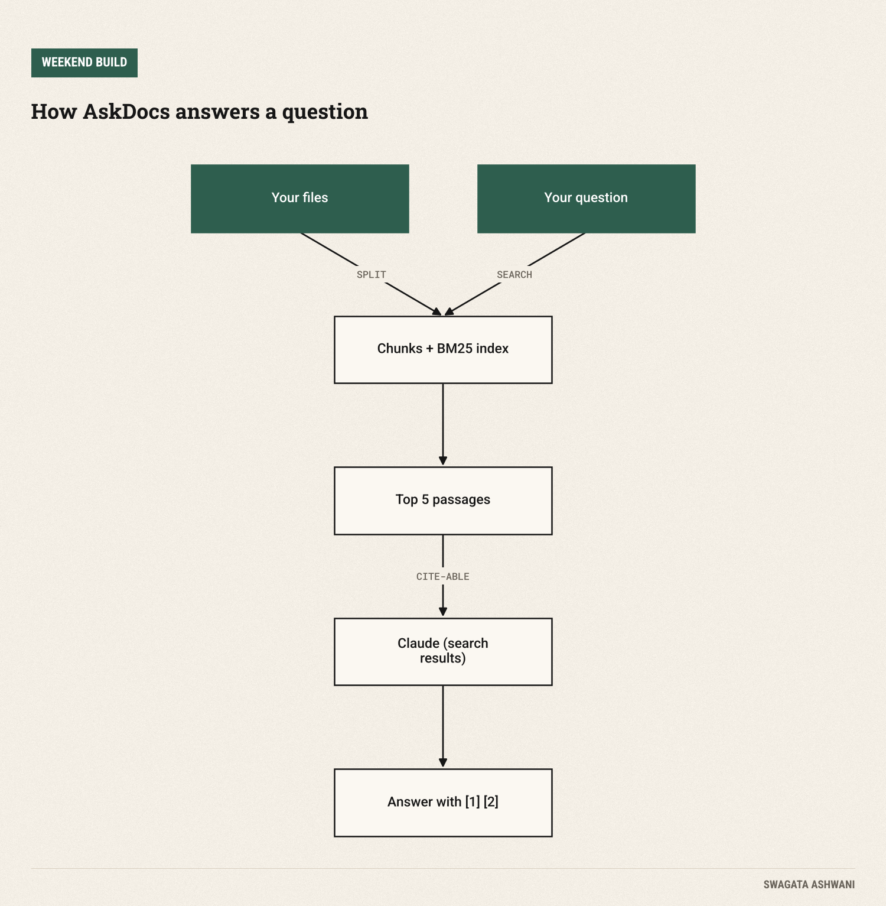
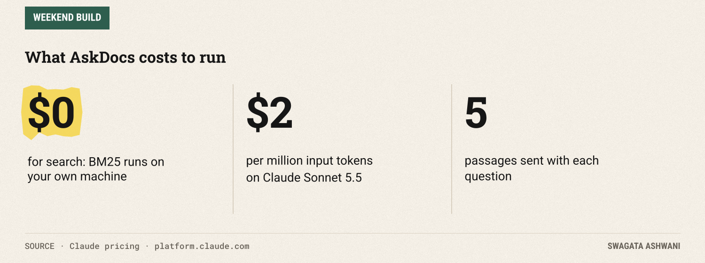
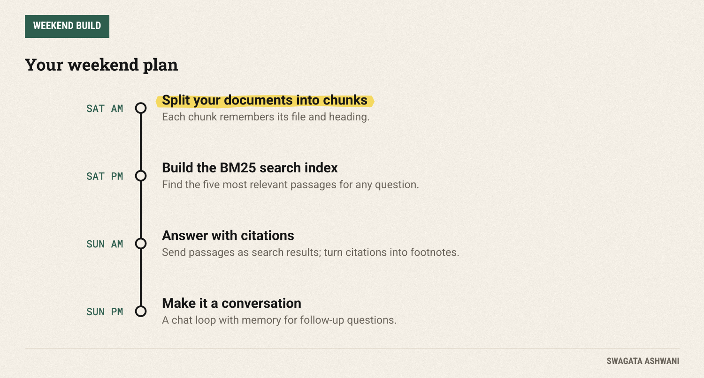

# Build a chatbot that answers from your own documents

*AskDocs finds the right passages, cites the exact file, and admits when it doesn't know. About 100 lines of Python.*



Every team has a pile of documents nobody can find anything in: policies, meeting notes, specs, the onboarding wiki. This weekend you'll build **AskDocs**, a chatbot that answers questions from *your* files, cites the exact file for every answer, and says "I don't know" when the answer isn't there.

This pattern is called RAG, retrieval-augmented generation. It sounds fancy. It's three steps: find the relevant passages, hand them to the model, and ask it to answer only from them. We'll build it in about 100 lines of Python, with no vector database and no embeddings bill.

")

## What you'll build

You point AskDocs at a folder of Markdown or text files and start asking questions:

1. **Indexing.** Every file is split into paragraph-sized chunks that remember which file they came from.
2. **Search.** For each question, a classic keyword ranking method called BM25 finds the five most relevant chunks.
3. **Answering.** Those chunks go to Claude as *search results*. Claude answers using only them, and attaches a citation to each claim.
4. **Footnotes.** Your code turns the citations into [1], [2] markers with the file paths, so anyone can check the answer.



## Before you start

You need Python 3.10+, a Claude API key from the [Claude Console](https://platform.claude.com), and a folder of `.md` or `.txt` files to test with. (An exported wiki or a few policy docs is perfect.)

```bash
mkdir askdocs && cd askdocs
python -m venv .venv && source .venv/bin/activate
pip install anthropic rank-bm25
export ANTHROPIC_API_KEY="your-key-here"
```

**Cost.** Search runs on your laptop and costs nothing. Each answer is one call to Claude Sonnet 5.5 ($2 per million input tokens, $10 per million output), with five short passages attached, so a question costs a fraction of a cent ([pricing](https://platform.claude.com/docs/en/about-claude/pricing)).



## Saturday: split, search and retrieve

### Step 1: Split your documents into chunks

Create `askdocs.py` and start with loading and splitting:

```python
"""AskDocs: chat with your own documents, with a source for every answer."""
import re
import sys
from pathlib import Path

import anthropic
from rank_bm25 import BM25Plus

MODEL = "claude-sonnet-5-5"
client = anthropic.Anthropic()  # reads ANTHROPIC_API_KEY

SYSTEM = """You answer questions using only the documents provided in the conversation.
If the documents don't contain the answer, say so plainly and suggest what to look for instead.
Never fill gaps from general knowledge. Keep answers short and specific."""

def load_chunks(folder: str, max_chars: int = 900) -> list[dict]:
    """Split every .md and .txt file into paragraph-sized chunks that remember where they came from."""
    chunks = []
    for path in sorted(Path(folder).rglob("*")):
        if path.suffix.lower() not in {".md", ".txt"}:
            continue
        text = path.read_text(errors="ignore")
        heading = next((l.lstrip("# ").strip() for l in text.splitlines() if l.startswith("#")), path.stem)
        buf = ""
        for para in re.split(r"\n\s*\n", text):
            if buf and len(buf) + len(para) > max_chars:
                chunks.append({"source": str(path), "title": heading, "text": buf.strip()})
                buf = ""
            buf += para + "\n\n"
        if buf.strip():
            chunks.append({"source": str(path), "title": heading, "text": buf.strip()})
    return chunks

def tokenize(text: str) -> list[str]:
    return re.findall(r"[a-z0-9]+", text.lower())
```

Why chunks? A model answers better from five relevant paragraphs than from fifty pages, and it's cheaper. Each chunk keeps its `source` (the file path) and `title` (the file's first heading), which is what the citations will point to later.

### Step 2: Search with BM25

Add a small search index:

```python
class Index:
    """Keyword search over chunks with BM25: fast, free, and no embeddings needed."""

    def __init__(self, chunks: list[dict]):
        self.chunks = chunks
        self.tokens = [tokenize(c["text"]) for c in chunks]
        self.bm25 = BM25Plus(self.tokens)  # the "Plus" variant still works when you only have a few files

    def search(self, query: str, k: int = 5) -> list[dict]:
        words = set(tokenize(query))
        scores = self.bm25.get_scores(list(words))
        best = sorted(range(len(scores)), key=lambda i: scores[i], reverse=True)
        return [self.chunks[i] for i in best if words & set(self.tokens[i])][:k]
```

BM25 is the ranking method behind most traditional search engines: it scores chunks by how many of your query's words they contain, giving more weight to rare words. It's not as clever as embedding-based "semantic" search, but it's free, instant, easy to debug, and very good for documents full of specific terms like policy names and product codes.

One lesson from testing this: the standard BM25 variant gives *zero* weight to a word that appears in half your documents, so with only two or three files it can find nothing at all. The `BM25Plus` variant fixes that, and we only keep chunks that share at least one word with the question.

**Check before moving on:** in a Python shell, run `import askdocs; idx = askdocs.Index(askdocs.load_chunks("docs")); [h["title"] for h in idx.search("your question")]`. You should see the titles of the files you'd expect.

## Sunday: answers with receipts

### Step 3: Ask Claude, with citations

Now the part that makes this trustworthy:

```python
def as_search_results(hits: list[dict]) -> list[dict]:
    """Hand the retrieved chunks to Claude as search results, so it can cite them."""
    return [{"type": "search_result", "source": h["source"], "title": h["title"],
             "content": [{"type": "text", "text": h["text"]}], "citations": {"enabled": True}}
            for h in hits]

def ask(index: Index, question: str, history: list[dict]) -> tuple[str, list[str]]:
    hits = index.search(question + " " + (history[-2]["content"] if len(history) >= 2 else ""))
    if not hits:
        return "I couldn't find anything about that in your documents.", []
    messages = history + [{"role": "user", "content": as_search_results(hits) + [{"type": "text", "text": question}]}]
    response = client.messages.create(model=MODEL, max_tokens=4000, system=SYSTEM, messages=messages,
                                      thinking={"type": "adaptive"}, output_config={"effort": "low"})
    if response.stop_reason == "refusal":
        return "Claude declined to answer that.", []
    sources, parts = [], []
    for block in response.content:
        if block.type != "text":
            continue
        marks = ""
        for c in block.citations or []:
            if c.type == "search_result_location":
                if c.source not in sources:
                    sources.append(c.source)
                n = sources.index(c.source) + 1
                if f"[{n}]" not in marks:
                    marks += f"[{n}]"
        parts.append(block.text + marks)
    return "".join(parts).strip(), sources
```

The key move is `as_search_results`. Instead of pasting passages into a big prompt, we send them as [search result blocks](https://platform.claude.com/docs/en/build-with-claude/search-results), the same format Claude uses for web search. That lets Claude attach precise citations to its answer, each carrying the `source` and `title` you supplied. One rule to know: citations are all-or-nothing, so enable them on every result or none.

The system prompt does the rest: answer only from the documents, and say plainly when they don't contain the answer. That "I don't know" is a feature. A chatbot that confidently invents your leave policy is worse than no chatbot.

### Step 4: Make it a conversation

Finally, a simple chat loop:

```python
def chat(folder: str) -> None:
    index = Index(load_chunks(folder))
    print(f"Indexed {len(index.chunks)} chunks from {folder}. Ask away (empty line to quit).")
    history: list[dict] = []
    while question := input("\nYou: ").strip():
        answer, sources = ask(index, question, history)
        print(f"\nAskDocs: {answer}")
        for n, s in enumerate(sources, 1):
            print(f"  [{n}] {s}")
        history += [{"role": "user", "content": question}, {"role": "assistant", "content": answer}]
        history = history[-8:]  # keep the last four exchanges for follow-up questions

if __name__ == "__main__":
    chat(sys.argv[1] if len(sys.argv) > 1 else "docs")
```

We keep the last four exchanges so follow-ups like "and what about contractors?" make sense, and we add the previous question to the search so the right passages come back. Then run it:

```bash
python askdocs.py path/to/your/docs
```



## Common pitfalls

- **Chunks that are too big or too small.** Too big and you waste tokens; too small and passages lose context. Paragraph-sized chunks of up to 900 characters are a good start.
- **Keyword mismatch.** BM25 won't match "vacation" to "leave". If people ask questions in different words than your documents use, add synonyms to your files, or upgrade the search (below).
- **Letting the model fill gaps.** Keep the "only from the documents" instruction, and test it with a question you know isn't covered.
- **Stale indexes.** The index is rebuilt every time you start AskDocs, which is fine for small folders. For large ones, save it to disk.
- **Sensitive files.** Anything in the folder can end up in an answer. Point it only at documents everyone using it is allowed to read.

## Take it further

- **Semantic search.** Swap BM25 for embeddings to match meaning, not just words, or combine both and merge the results.
- **PDFs and Word files.** Add a converter step so the folder can hold any format.
- **A team version.** Put it behind a Slack command so anyone can ask.
- **Measure it.** Write ten questions with known answers and check AskDocs gets them right after every change. (That's the next Weekend Build.)

## Resources

- [Search result content blocks](https://platform.claude.com/docs/en/build-with-claude/search-results)
- [rank_bm25 on GitHub](https://github.com/dorianbrown/rank_bm25)
- [Anthropic Python SDK](https://github.com/anthropics/anthropic-sdk-python)
- [Claude pricing](https://platform.claude.com/docs/en/about-claude/pricing)

Happy building, and tell me what you pointed it at. Swagata
