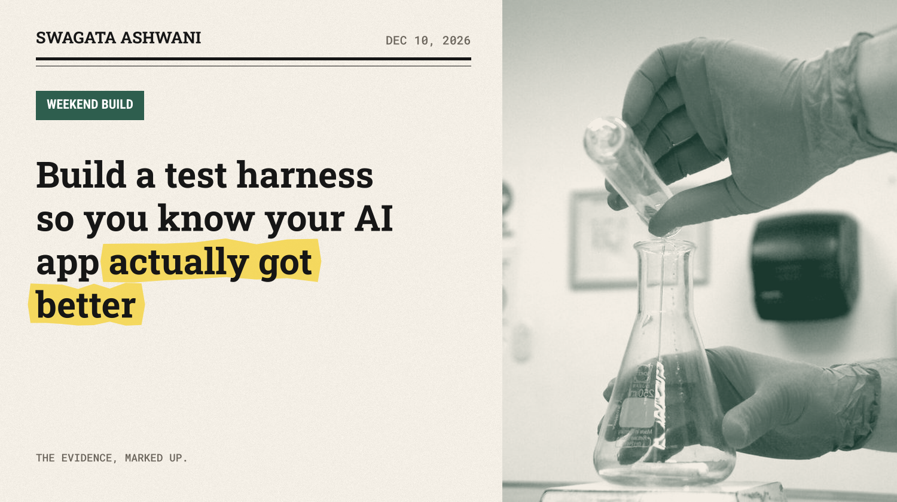
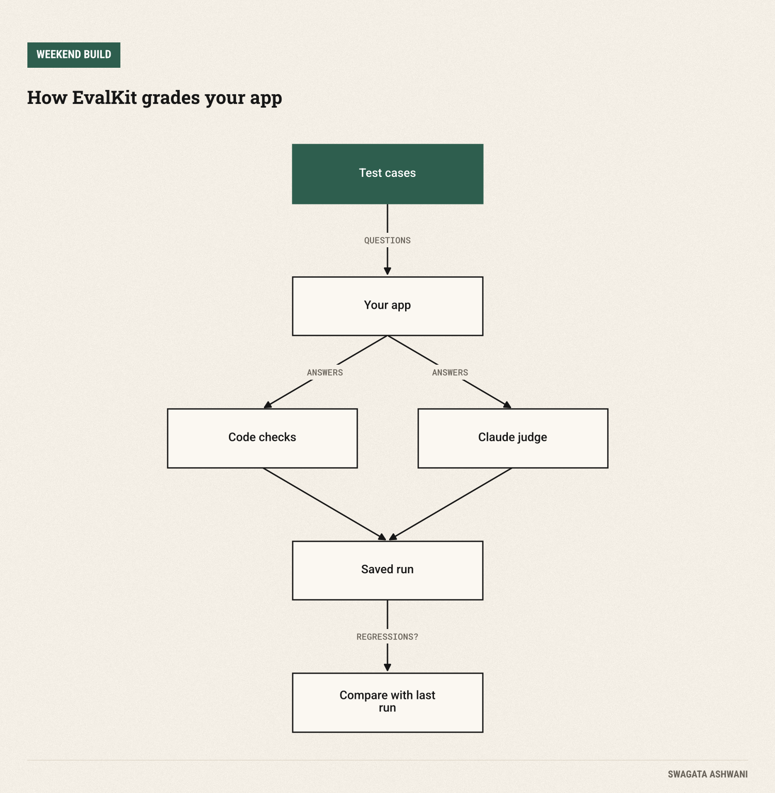
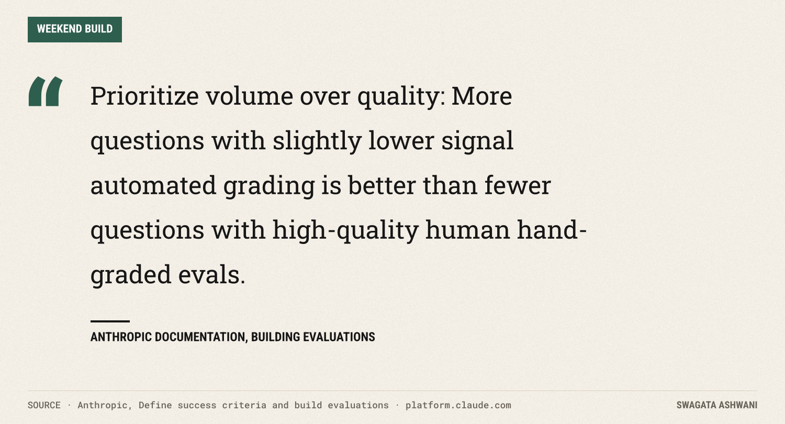
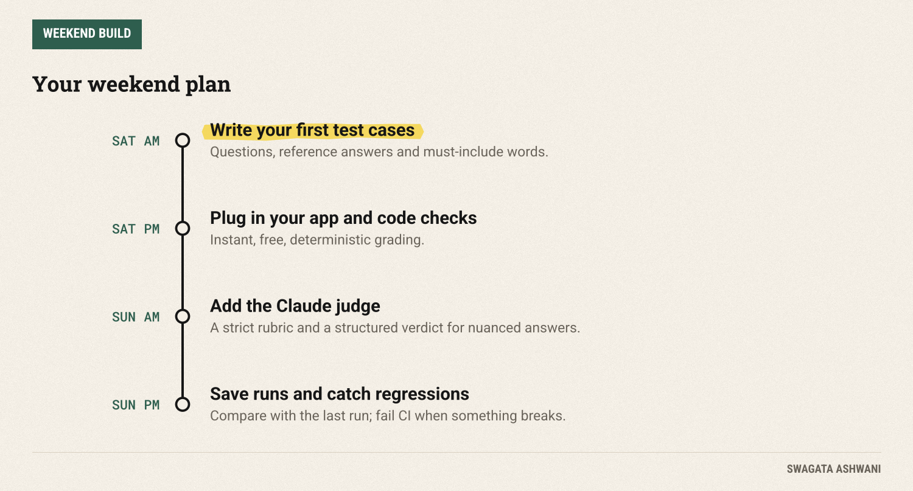

# Build a test harness so you know your AI app actually got better

*EvalKit runs your test questions, grades every answer two ways, and flags anything that got worse.*



You changed one line in a prompt and the answers feel better. Do they? Or did you fix the question you were looking at and quietly break three others? Without tests, every change to an LLM app is a guess.

This weekend you'll build **EvalKit**, a small test harness you can point at any AI app, including the chatbots from earlier Weekend Builds. It runs a set of test questions, grades every answer two ways, saves the results, and tells you exactly which questions got worse since the last run.

")

## What you'll build

1. **A test file.** One line per case: a question, a reference answer, and any words the answer must or must not contain.
2. **Two graders.** Fast code checks catch the obvious failures. A Claude "judge" with a strict rubric handles the nuanced ones.
3. **A run log.** Every run is saved, so you can see your pass rate move over time.
4. **Regression alerts.** If something passed last time and fails now, EvalKit names it and exits with an error code, so it can block a bad change automatically.



The approach follows [Anthropic's own guidance on evals](https://platform.claude.com/docs/en/test-and-evaluate/develop-tests): automate the grading, start with the fastest reliable checks, and use a model as judge where rules can't capture the nuance.

## Before you start

You need Python 3.10+, a Claude API key from the [Claude Console](https://platform.claude.com), and an app to test. If you built AskDocs two weeks ago, use that; otherwise EvalKit ships with a tiny example app.

```bash
mkdir evalkit && cd evalkit
python -m venv .venv && source .venv/bin/activate
pip install anthropic pydantic
export ANTHROPIC_API_KEY="your-key-here"
```

**Cost.** Each case costs one call to your app plus one call to the judge on Claude Opus 5.5 ($4 per million input tokens, $20 per million output; [pricing](https://platform.claude.com/docs/en/about-claude/pricing)). A run of 50 short cases costs cents, which is cheap insurance for a production app.

## Saturday: test cases and graders

### Step 1: Write your first test cases

Create `cases.jsonl`. Each line is one case:

```json
{"id": "leave-days", "input": "How many days of paid leave do employees get?", "must_include": ["25"], "reference": "Employees get 25 days of paid leave per year."}
{"id": "carry-over", "input": "Can I carry unused leave into next year?", "must_include": ["5"], "reference": "Up to 5 unused days can carry over."}
{"id": "not-covered", "input": "What is the parental leave policy?", "must_not_include": ["weeks of paid parental leave"], "reference": "The documents don't cover parental leave, so the assistant should say it doesn't know."}
```

Three cases is a start, not a test suite. Aim for 30 to 50 by the end of the weekend: common questions, tricky ones, and at least a few your app *shouldn't* answer, like the parental leave case above. Anthropic's advice is blunt:



Good sources of cases: real questions from users, support tickets, and every bug you've ever fixed. Each bug becomes a case so it can never quietly come back.

### Step 2: Plug in your app and the code checks

Create `evalkit.py`. The first part is the app under test, which you replace with a call into your own:

```python
"""EvalKit: a small, honest test harness for an LLM app."""
import json
import sys
from concurrent.futures import ThreadPoolExecutor
from datetime import datetime
from pathlib import Path

import anthropic
from pydantic import BaseModel, Field

JUDGE_MODEL = "claude-opus-5-5"  # the judge should be at least as capable as the app it grades
client = anthropic.Anthropic()

# ---- 1. The app under test. Replace this with a call into your own app. --------------------------
def app(question: str) -> str:
    response = client.messages.create(
        model="claude-sonnet-5-5", max_tokens=2000,
        system="You are the HR assistant. Answer only from company policy; say you don't know otherwise.",
        messages=[{"role": "user", "content": question}],
    )
    return "".join(b.text for b in response.content if b.type == "text")
```

Then the first grader:

```python
# ---- 2. Graders -----------------------------------------------------------------------------------
def code_checks(case: dict, output: str) -> list[str]:
    """Cheap, exact, deterministic checks. Always run these first."""
    problems = []
    for text in case.get("must_include", []):
        if text.lower() not in output.lower():
            problems.append(f"missing '{text}'")
    for text in case.get("must_not_include", []):
        if text.lower() in output.lower():
            problems.append(f"should not contain '{text}'")
    return problems
```

Code checks are dumb on purpose. They're instant, free and never inconsistent. If the answer to "how many days of leave?" doesn't contain "25", no amount of eloquence should make it pass.

## Sunday: the judge, the runs and the alarms

### Step 3: Add an LLM judge

Some answers can't be checked with string matching: "Yes, five days roll over" and "you can carry up to 5 unused days" both say the same thing. That's what the judge is for:

```python
class Verdict(BaseModel):
    score: int = Field(description="1 (wrong or harmful) to 5 (correct, complete and clear)")
    passed: bool = Field(description="True only if the answer is correct and matches the reference in substance")
    reason: str = Field(description="One sentence explaining the score")

RUBRIC = """You grade answers from an AI assistant. Compare the answer with the reference.
Pass it only if it is factually consistent with the reference and answers the question.
An honest "I don't know" is correct when the reference says the information isn't available.
Ignore style and length. Be strict about facts."""

def judge(case: dict, output: str) -> Verdict:
    response = client.messages.parse(
        model=JUDGE_MODEL, max_tokens=2000, system=RUBRIC, output_format=Verdict,
        thinking={"type": "adaptive"}, output_config={"effort": "medium"},
        messages=[{"role": "user", "content": f"Question: {case['input']}\n\nReference: {case['reference']}"
                   f"\n\n<answer>\n{output}\n</answer>"}],
    )
    return response.parsed_output or Verdict(score=1, passed=False, reason="Judge returned no verdict.")
```

Three details make the judge trustworthy. It returns a structured `Verdict`, so there's nothing to parse. The rubric tells it to ignore style and focus on facts, because judges otherwise reward longer, friendlier answers. And it runs on a model at least as capable as the app it's grading.

### Step 4: Run, save and compare

The rest of the file runs every case, saves the results and looks for regressions:

```python
# ---- 3. Run, score and compare ----------------------------------------------------------------------
def run_case(case: dict) -> dict:
    output = app(case["input"])
    problems = code_checks(case, output)
    verdict = judge(case, output)
    return {"id": case["id"], "passed": verdict.passed and not problems, "score": verdict.score,
            "problems": problems, "reason": verdict.reason, "output": output}

def compare(results: list[dict], previous_file: Path | None) -> list[str]:
    """Which cases passed last time but fail now?"""
    if not previous_file:
        return []
    before = {r["id"]: r["passed"] for r in json.loads(previous_file.read_text())["results"]}
    return [r["id"] for r in results if before.get(r["id"]) and not r["passed"]]

def main(cases_file: str = "cases.jsonl") -> int:
    cases = [json.loads(line) for line in Path(cases_file).read_text().splitlines() if line.strip()]
    with ThreadPoolExecutor(max_workers=4) as pool:
        results = list(pool.map(run_case, cases))

    runs = Path("runs")
    runs.mkdir(exist_ok=True)
    previous = max(runs.glob("*.json"), default=None)
    regressions = compare(results, previous)
    passed = sum(r["passed"] for r in results)
    stamp = datetime.now().strftime("%Y%m%d-%H%M%S")
    (runs / f"{stamp}.json").write_text(json.dumps({"passed": passed, "total": len(results), "results": results}, indent=2))

    for r in results:
        mark = "PASS" if r["passed"] else "FAIL"
        print(f"{mark}  {r['id']:<14} score {r['score']}  {'; '.join(r['problems']) or r['reason']}")
    print(f"\n{passed}/{len(results)} passed ({passed / len(results):.0%})")
    if regressions:
        print("Regressions since last run: " + ", ".join(regressions))
    return 1 if regressions else 0  # a non-zero exit code lets CI block a bad change

if __name__ == "__main__":
    sys.exit(main(*sys.argv[1:]))
```

Run it:

```bash
python evalkit.py
```

You'll get one line per case and a pass rate. Change your prompt, run it again, and if a case that used to pass now fails, EvalKit names it.



When I tested this, one run nicely showed why you want both graders: the app gave a wrong number of leave days, the simulated judge was fooled, and the simple "must include 25" check caught it anyway. Belt and braces.

## Common pitfalls

- **Too few cases.** Five cases tell you almost nothing; one lucky answer swings the score by 20%. Grow the suite every week.
- **Testing only happy paths.** Include questions your app should refuse or answer with "I don't know". Those failures do the most damage.
- **Trusting the judge blindly.** Read a sample of its verdicts each week. If you disagree with it, fix the rubric.
- **Ignoring randomness.** Model outputs vary. For important decisions, run the suite twice and look at cases that flip.
- **Never running it.** Add `python evalkit.py` to your CI pipeline; the non-zero exit code on regressions blocks the merge for you.

## Take it further

- **Track trends.** Plot the pass rate from the `runs/` folder over time.
- **Compare models or prompts side by side** by running the suite against two versions of `app()`.
- **Grade more than correctness:** tone, length, or whether every claim has a citation.
- **Test the other Weekend Builds.** Point EvalKit at Scout, AskDocs or your agent team.

## Resources

- [Anthropic: Define success criteria and build evaluations](https://platform.claude.com/docs/en/test-and-evaluate/develop-tests)
- [Structured outputs](https://platform.claude.com/docs/en/build-with-claude/structured-outputs)
- [Anthropic Python SDK](https://github.com/anthropics/anthropic-sdk-python)
- [Claude pricing](https://platform.claude.com/docs/en/about-claude/pricing)

Test early, test often. Swagata
