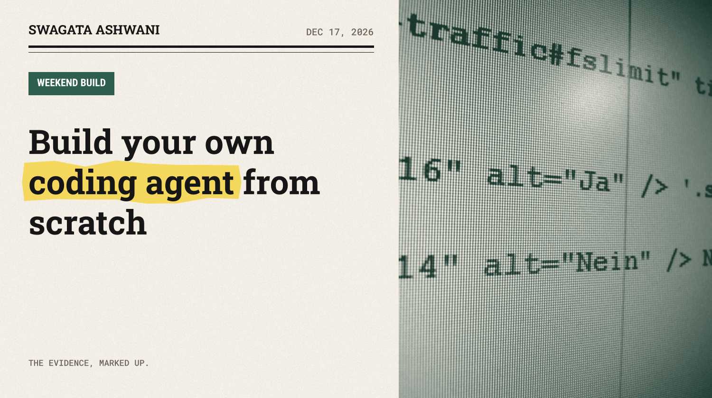
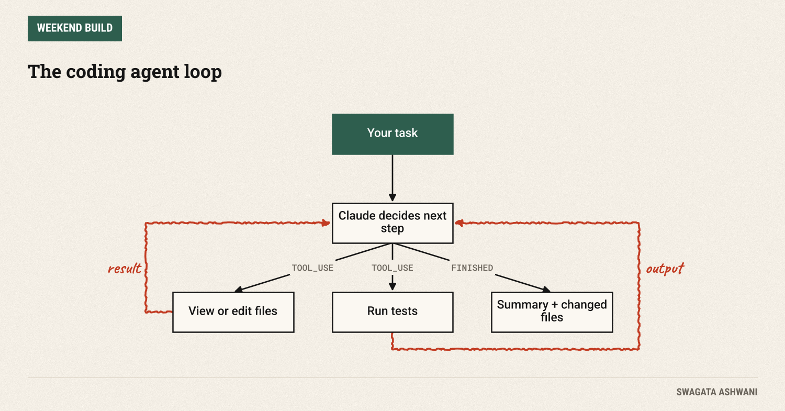
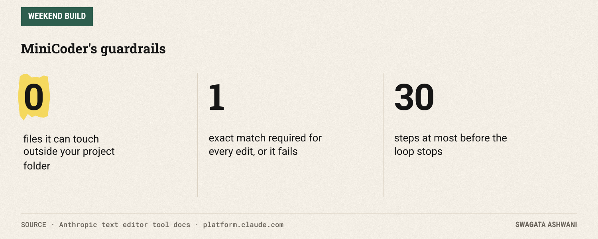
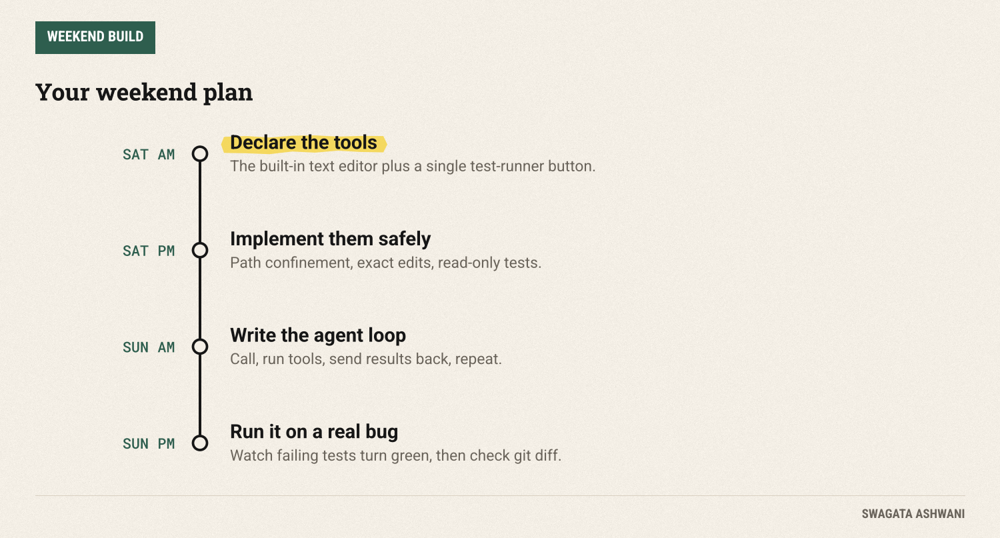

# Build your own coding agent from scratch

*MiniCoder reads your code, edits it, runs the tests and tries again, with guardrails built in. About 120 lines.*



Coding agents like Claude Code and Cursor feel like magic. Underneath, the core is surprisingly small: a loop where the model looks at files, edits them, runs the tests, reads the results and tries again. This weekend you'll build that loop yourself.

**MiniCoder** is about 120 lines of Python. You give it a task, like "make all the tests pass" or "add input validation to the signup function", and it reads your project, makes careful edits, runs your test suite, and keeps going until the tests pass or it gives up. By Sunday you'll understand exactly how the big tools work, and where they can go wrong.

")

## What you'll build

MiniCoder gives Claude two tools and a loop:

1. **A text editor** to view files and make precise edits. This is a built-in Anthropic tool: Claude already knows how to use it; your code just carries out the actions.
2. **A test runner** that runs your project's tests with pytest and returns the output.
3. **The loop:** call Claude, run whatever tools it asks for, send the results back, repeat, until it says it's done or hits a step limit.



The interesting engineering isn't the loop. It's the guardrails: an agent that can edit files is an agent that can edit the *wrong* files. We'll build three safety rails in from the start.

## Before you start

You need Python 3.10+, a Claude API key from the [Claude Console](https://platform.claude.com), and a small Python project with tests. (No project? Make one with a deliberately broken function and a test for it.)

```bash
mkdir minicoder && cd minicoder
python -m venv .venv && source .venv/bin/activate
pip install anthropic pytest
export ANTHROPIC_API_KEY="your-key-here"
```

**Always run it on a copy of your project, or a folder under git,** so you can see and undo every change with `git diff`.

**Cost.** MiniCoder runs on Claude Sonnet 5.5 ($2 per million input tokens, $10 per million output; [pricing](https://platform.claude.com/docs/en/about-claude/pricing)). Each step resends the conversation, so long tasks add up; a small bug fix typically takes a handful of steps and costs cents. The 30-step cap protects you from runaway bills.

## Saturday: tools with guardrails

### Step 1: Declare the tools

Create `minicoder.py` and start with the setup:

```python
"""MiniCoder: a small coding agent that reads, edits and tests code in one project folder."""
import subprocess
import sys
from pathlib import Path

import anthropic

MODEL = "claude-sonnet-5-5"
MAX_STEPS = 30  # hard cap on tool calls per task
client = anthropic.Anthropic()  # reads ANTHROPIC_API_KEY

TOOLS = [
    {"type": "text_editor_20250728", "name": "str_replace_based_edit_tool"},  # built-in: Claude knows how to use it
    {"name": "run_tests", "description": "Run the project's test suite with pytest and return the output.",
     "input_schema": {"type": "object", "properties": {}, "additionalProperties": False}},
]

SYSTEM = """You are a careful software engineer working in a single project folder.
Workflow: look at the relevant files, make the smallest change that solves the task, then run the
tests. If tests fail, read the output, fix the cause, and run them again. Finish with a short
summary of what you changed and the final test result. Never edit test files to make them pass."""
```

The text editor is declared with just a `type` and `name`, with no schema: it's an [Anthropic-defined tool](https://platform.claude.com/docs/en/agents-and-tools/tool-use/text-editor-tool) that Claude is trained to use. The test runner is our own tool, with an empty schema because it takes no arguments.

Notice what's missing: a general shell. It would be easy to give the agent a terminal and let it run anything. Anthropic's guidance is to treat every command as untrusted and use an allowlist, and the tightest allowlist is one command. If MiniCoder needs to run tests, it gets a button that runs tests. Nothing else.

### Step 2: Implement the tools safely

Now the code that actually touches your files:

```python
# ---- The tools, implemented on your machine --------------------------------------------------------
class Workspace:
    def __init__(self, root: str):
        self.root = Path(root).resolve()
        self.changed: set[str] = set()

    def safe_path(self, path: str) -> Path:
        """Resolve a model-supplied path and refuse anything outside the project folder."""
        p = (self.root / path.lstrip("/")).resolve()
        if not p.is_relative_to(self.root):
            raise ValueError(f"{path} is outside the project folder")
        return p

    def edit(self, args: dict) -> str:
        cmd, p = args["command"], self.safe_path(args["path"])
        if cmd == "view":
            if p.is_dir():
                return "\n".join(sorted(str(f.relative_to(self.root)) for f in p.rglob("*")
                                        if f.is_file() and ".git" not in f.parts and "__pycache__" not in f.parts))
            lines = p.read_text().splitlines()
            start, end = (args.get("view_range") or [1, len(lines)])
            end = len(lines) if end == -1 else end
            return "\n".join(f"{i}: {lines[i - 1]}" for i in range(start, end + 1))
        if p.name.startswith("test_"):
            raise ValueError("test files are read-only")
        if cmd == "create":
            p.parent.mkdir(parents=True, exist_ok=True)
            p.write_text(args["file_text"])
        elif cmd == "str_replace":
            text = p.read_text()
            count = text.count(args["old_str"])
            if count != 1:
                raise ValueError(f"old_str must match exactly once, found {count} matches")
            p.write_text(text.replace(args["old_str"], args.get("new_str", "")))
        elif cmd == "insert":
            lines = p.read_text().splitlines(keepends=True)
            lines.insert(args["insert_line"], args["insert_text"].rstrip("\n") + "\n")
            p.write_text("".join(lines))
        else:
            raise ValueError(f"unknown command {cmd}")
        self.changed.add(str(p.relative_to(self.root)))
        return f"{cmd} ok: {args['path']}"

    def run_tests(self) -> str:
        result = subprocess.run([sys.executable, "-m", "pytest", "-q", "--no-header"], cwd=self.root,
                                capture_output=True, text=True, timeout=120)
        return (result.stdout + result.stderr)[-6000:] or "(no output)"
```



Three guardrails live here:

- **Stay in the folder.** `safe_path` resolves every path the model gives and refuses anything outside the project. A request for `../../../etc/passwd` gets an error, not a file.
- **Exact edits only.** `str_replace` must match exactly one place in the file. If the text appears zero times or twice, it fails and Claude has to look again. This one rule prevents most accidental damage.
- **Tests are off limits.** An agent told to "make the tests pass" will sometimes take the shortcut of changing the tests. Making test files read-only removes the temptation entirely.

**Check before moving on:** in a Python shell, `import minicoder; ws = minicoder.Workspace("."); print(ws.edit({"command": "view", "path": "."}))` should list your files, and `ws.edit({"command": "view", "path": "../.."})` should raise an error.

## Sunday: the agent loop

### Step 3: Write the loop

This is the whole agent:

```python
# ---- The agent loop ---------------------------------------------------------------------------------
def solve(task: str, root: str = ".") -> str:
    ws = Workspace(root)
    messages = [{"role": "user", "content": task}]
    for step in range(MAX_STEPS):
        response = client.messages.create(
            model=MODEL, max_tokens=16000, system=SYSTEM, tools=TOOLS, messages=messages,
            thinking={"type": "adaptive"}, output_config={"effort": "medium"},
        )
        messages.append({"role": "assistant", "content": response.content})
        if response.stop_reason != "tool_use":
            print(f"\nChanged files: {', '.join(sorted(ws.changed)) or 'none'}")
            return "".join(b.text for b in response.content if b.type == "text")

        results = []
        for block in response.content:
            if block.type != "tool_use":
                continue
            try:
                output = ws.run_tests() if block.name == "run_tests" else ws.edit(block.input)
                results.append({"type": "tool_result", "tool_use_id": block.id, "content": output})
            except Exception as exc:  # tell Claude what went wrong so it can recover
                results.append({"type": "tool_result", "tool_use_id": block.id, "content": str(exc), "is_error": True})
            print(f"  [{step + 1}] {block.name} {block.input.get('command', '')} {block.input.get('path', '')}")
        messages.append({"role": "user", "content": results})  # all results go back in one message
    return f"Stopped after {MAX_STEPS} steps without finishing."

if __name__ == "__main__":
    print(solve(" ".join(sys.argv[1:]) or "Make all the tests pass."))
```

Read it slowly, because every coding agent has this shape:

1. Send the conversation and the tools to Claude.
2. If Claude's answer ends with `tool_use`, run each requested tool and collect the results.
3. Send **all** the results back together in one message, then go around again.
4. When Claude stops asking for tools, it's done: print what changed and its summary.

Two details matter. When a tool fails, we don't crash: we send the error back with `is_error: True`, and Claude reads it and adapts, just like a person reading an error message. And `MAX_STEPS` guarantees the loop ends, even if the model gets stuck.

### Step 4: Run it

```bash
python minicoder.py "Make all the tests pass."
python minicoder.py "Add a function that returns the median of a list, with tests."
```

You'll see each step as it happens (view, edit, run tests), then the list of changed files and Claude's summary. Check the result with `git diff` before you keep anything.

When I tested it on a tiny project with a broken `average()` function, the run went exactly as designed: it listed the files, was refused when it tried to read outside the folder, was refused when it tried to edit the test, fixed the real bug, and watched the tests go from failing to passing.



## Common pitfalls

- **Giving it a full shell.** It's tempting. Don't, unless it runs in a container you're happy to throw away.
- **Running it on your only copy.** Use git, every time.
- **Vague tasks.** "Improve the code" invites sprawling edits. "Fix the failing test in test_stats.py" gets a tight change.
- **No tests at all.** Without tests the agent can't check its own work, and neither can you. Write one test for the behaviour you want first.
- **Letting it loop forever.** Keep the step cap. If it can't solve a task in 30 steps, it's usually confused about the task, not one step away from success.

## Take it further

- **Show diffs before applying.** Print each proposed edit and ask "apply? (y/n)" for a human in the loop.
- **Add a search tool** that runs a fixed `grep` so it can find code in bigger projects.
- **Run it in a container** so you can safely allow more commands, like installing packages.
- **Test the tester.** Use last week's EvalKit to measure how often MiniCoder solves a set of known bugs.

## Resources

- [Text editor tool docs](https://platform.claude.com/docs/en/agents-and-tools/tool-use/text-editor-tool)
- [Tool use overview](https://platform.claude.com/docs/en/agents-and-tools/tool-use/overview)
- [Anthropic Python SDK](https://github.com/anthropics/anthropic-sdk-python)
- [Claude pricing](https://platform.claude.com/docs/en/about-claude/pricing)

Happy hacking, and tell me the first bug it fixes for you. Swagata
